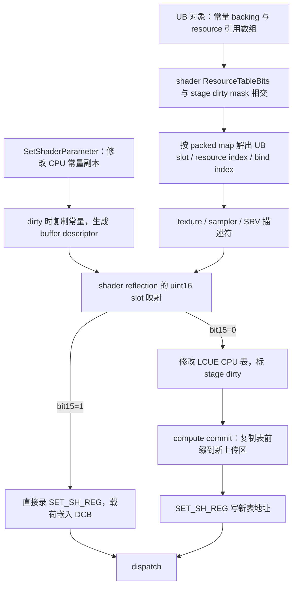

# KH3 GnmRHI 语义还原：参数、资源绑定、LCUE 与 dispatch

本篇接续[提交、缓冲与回收还原](kh3-gnmrhi-reconstruction.md)，深入到一次 draw / dispatch 如何取得它实际使用的数据。依据仍是 **KH3 CUSA15072 01.10、`++UE4+Release-4.17` 分支**，不是按公开 4.18 或现代 UE 的接口重写。分析日期 2026-10-16；本轮为静态分析，没有操作设备。

新增了[可运行语义模型](../../tools/gnmrhi-semantics/model.py)和[场景测试](../../tools/gnmrhi-semantics/test_model.py)。它们用于解释、解码和验证还原过程中的不变量，不是可链接的 PS4 RHI，也不模拟 GPU 执行。名称为研究者命名，新函数、原型、布局均以 `candidate` 写入 [v2 符号分片](../../guest/games/CUSA15072/01.10/symbols/gnmrhi-binding.symbols.json)。

按用户后续要求又补了[可编译的 C++20 语义库](../../tools/gnmrhi-semantics/cpp/README.md)：实现本文的参数 / 绑定 / compute 链路，另含前篇的多缓冲 Lock、ticket 回收和 query 就绪核心。它通过显式后端接口接分配器和 SDK，尚未恢复的模块不填成假实现。Windows x64 Release 编译、13 个内部场景测试已通过。

后续补充：[与 UE 实现直接关联的参考版](kh3-gnmrhi-ue-reference.md)。新恢复 CS shader / parameter / UB setter，区分立即绑定 UB 常量与 dispatch 时展开资源，并把语义实现拆到 UE 的 `FGnmCommandContext`、`FGnmDynamicRHI` 和 `FRHIResource` 派生对象；符号索引升至 revision 4。本文“shader/UB dirty 产生尚未恢复”的边界由该篇局部推进，仍不代表全部 reset / pipeline 路径已闭合。

## 1. 证据边界与主要结果

后续 graphics 闭环见 [graphics/draw 深入还原](kh3-gnmrhi-graphics.md)。本篇记录的是r3范围；普通VS/PS LCUE、BSS dirty、vertex fetch/instancing已在后续参考中推进，GS/tess仍有缺口。原r3符号中 context+928 的 declaration 解释已纠正：该处是stream0 GPU地址，declaration在+aa8。

原始 ELF SHA256：`29524c8302995aac8207e69b3e16da81410bce4685d9b010d011c3dec72990b9`。下文所有地址都是 **eboot 模块偏移**。反汇编使用原始 ELF；IDA 对分析 ELF 的反编译用来交叉阅读，原型和小整数宽度最终以指令为准。证据路径、运行时兼容身份、IDA 快照及其不同 SHA 见前篇 §1。

本轮逐函数反汇编在 `build/validation/kh3-gnmrhi-20261016/static/fn_<offset>.asm.txt`，原始 Hex-Rays 输出在同目录 `decomp/0x<offset>.cpp`；均留在本地 build 中。后者有寄存器参数、向量内联汇编、尾调用造成的噪声，不能直接编译成源码。

已经闭合的链路是：



关键区别有三处：**CPU 常量副本不等于已上传常量；LCUE staging 表不等于已上传的表；RHI buffer / SRV 对象不等于当前 backing 地址**。后续查错要把对象、版本地址、命令流位置一起保存。

## 2. loose constants：可修改的 CPU 副本与不可回改的上传版本

这条路径与前篇 `RHICreateUniformBuffer` 的对象生命周期分开。它承接零散 shader parameter 写入，再由 draw / dispatch 前的 commit 上传。

| 部分对象偏移 | 语义与指令依据 |
|---|---|
| `+0x40` | dirty byte；`0x368fdd` 置 1；上传 helper 不清 |
| `+0x48` | CPU shadow 指针；`0x368f8d` / `0x36d740` 读取 |
| `+0x50` | 自上次确认以来的最大更新末端；`0x368fc7–0x368fd8` |
| `+0x54` | 上次上传的 16 字节对齐长度；上传 helper 更新 |

`0x368f70` 的调用约定是 RDI=shadow 对象、RSI=源字节、EDX=offset、ECX=size。等价于：

```cpp
void WriteLooseConstants(Shadow& s, const void* src, uint32_t offset, uint32_t size) {
    memcpy(s.cpu + offset, src, size);
    s.updatedEnd = max(s.updatedEnd, offset + uint16_t(size));
    s.dirty = true;
}
```

**低 16 位不是笔误**：`0x368fcc` 用 `movzx eax,r15w` 计算 high-water，但大复制分支用整个 size。不能照 Hex-Rays 的临时变量类型推断整个 ABI 都是 uint16。模型只接受 size≤65535 且落在 shadow 容量内的输入；没有声称二进制自己进行了这些边界检查。

`0x36d740`：RDI=shadow、RSI=上下文、DL=是否丢弃旧 extent、RCX=输出 16 字节描述符。其主要语义：

```cpp
bool CommitLooseConstants(Shadow& s, Context& c, bool discardOldExtent, BufferDesc& out) {
    if (!s.dirty) return false;
    uint32_t copyBytes = discardOldExtent ? s.updatedEnd
                                         : max(s.updatedEnd, s.priorExtent);
    uint32_t allocBytes = Align16(copyBytes);
    s.priorExtent = allocBytes;
    void* dst = allocBytes > 65536 ? AllocateTransient(allocBytes, 1)
                                 : c.constantUpload.AllocateFrom64KiBBlock(allocBytes);
    memcpy(dst, s.cpu, copyBytes);
    out = {lo32(dst), (hi32(dst) & 0xfff) | 0x100000,
           allocBytes / 16, 0x20077fac};
    return true;  // dirty / updatedEnd 留给调用者清
}
```

上下文 `+0x50` 开始的上传分配记录：块数组指针 +50、count +58、capacity +5c、当前 cursor +60、块内已用字节 +68、块索引 +6c。小分配按 16 字节推进；不足时使用下一已存在块或向 `0x3beb60(0,0)` 要一个 64 KiB 块。大分配才进入前篇的 1 KiB / 8 MiB 临时分配器。这是两条不同的入口。

例：先写 offset=32,size=5，分配 48 字节、只复制 37 字节。下一次仅改前 4 字节，若 `discardOldExtent=false`，仍复制 48 字节，先前高地址常量得以保留；若为 true，则分配 16、复制 4。**对齐尾部未被本 helper 清零**，模型用 `copied` 长度保留这个区别。

直接 compute `0x36cfb0` 在 shader `+0x258` 非零时调用此 helper，DL=1；图形 `0x386680` 使用 context `+0xab5`，完成后把该标志清零。成功上传并走过绑定逻辑后，调用者清 `dirty` 和 `updatedEnd`，保留 `priorExtent`。仅凭重复 draw 没有 memcpy，不能判断常量没更新：还要看 dirty 的生产与确认。

## 3. uniform 资源表：三个索引域不能混用

shader 对象的已识别部分：

| shader 偏移 | 本轮解释 |
|---|---|
| `+0x200` | ResourceTableBits，32 位 UB 使用位图 |
| `+0x208` | SRV packed-map 数组指针 |
| `+0x218` | sampler packed-map 数组指针 |
| `+0x248` | texture packed-map 数组指针 |
| `+0x258` | compute 路径读取的 loose-constants 使用标志 |

三个 packed-map 数组都按下述规则消费。每个 UB slot 对应的 `map[slot]` 是**同一数组中的起始下标**，0 表示没有项。随后 uint32 元素编码为：

```text
31                 24 23                              8 7                 0
       UB slot                     resource index               bind index
```

`resource index` 选 UB `+0x20` 指向的引用数组；`bind index` 选该 shader 的 reflection 槽；`UB slot` 选上下文里当前绑定的 UB。不是把其中某个值直接当 SGPR 编号。

```cpp
active = shader.resourceTableBits & context.dirtyUniforms[stage];
while (active) {
    slot = ctz(active); active &= active - 1;
    resources = context.boundUniforms[stage][slot]->resources;
    for (kind : {Texture, SRV, Sampler}) {
        i = shader.map[kind][slot];
        if (i == 0) continue;
        while ((entry = shader.map[kind][i++]) >> 24 == slot)
            Bind(kind, uint8_t(entry), resources[uint16_t(entry >> 8)]);
    }
}
context.dirtyUniforms[stage] = 0;
```

最后清的是**整个 stage dirty mask**，不是只清本次 active 位。后续已在 [UE 关联分析](kh3-gnmrhi-ue-reference.md) 确认 CS UB setter 置对应位，CS shader setter 本体不写这个 mask；其它 reset / pipeline 路径仍需另查。不能让分析工具把无关 dirty 位自动沿用到下一 shader。本篇独立模型仍以捕获到的 dirty mask 和绑定资源作为输入。

| helper | UB 指针表（context 偏移） | dirty mask | GNM stage |
|---|---:|---:|---|
| `0x384e20` | `+0x548` | `+0x908` | 第三个参数；图形调用者从 shader +380 取值 |
| `0x3854b0` | `+0x728` | `+0x914` | 1，PS |
| `0x386240` | `+0x7c8` | `+0x918` | 3，GS |
| `0x36db40` | `+0x868` | `+0x91c` | 0，CS |

这里的 `0x1800` 是 **GNM stage 表间距**；context 的 UB 表采用 UE 的 shader-frequency 排列，两者不能直接共用一个 enum。未完整恢复 tessellation 路径，也没证明所有 UAV 都来自上述三种 map。

## 4. descriptor 到 SGPR / LCUE 表的映射

`gnm = *(context+0x440)`；LCUE 子对象从 `gnm+0x2e8` 开始。对应 stage 的 reflection 指针在 `gnm+0xc468+8*stage`；CPU descriptor 表基址为 `gnm+0x378+0x1800*stage`。

当前读取到的 reflection 槽：resource（texture / SRV）为 `+0x22+2*bindIndex`，sampler 为 `+0xa2+2*bindIndex`，loose constant buffer 使用 `+0xc2`。这些是本版布局，不是跨 SDK 的固定 ABI。

每项 uint16 的含义由绑定分支直接确定：

- `0xffff`：不复制描述符；已读 helper 仍标记该 stage dirty。
- bit15=0：在 CPU 表的 `4*(value&0x3fff)` 字节处复制描述符。
- bit15=1：向 user SGPR 发 `SET_SH_REG`；序号为 `value&0x3fff`，不是字节偏移。
- bit14 在这些 helper 中被掩掉；尚未恢复生成端含义，不能另起一个“bit14 路由”。

常量、buffer SRV、sampler 描述符为 4 dword，texture / texture SRV 为 8 dword。直接写的前导两 dword 为 `0xc0001000,0x6875000d`，随后 `SET_SH_REG` 的头为 `0xc0047600` 或 `0xc0087600`；CS 再 OR 2。第二 dword 是 `stageUserBase+slot-0x2c00`。

`0x7ed9e50` 的 uint16 表为：

| GNM stage | 0 CS | 1 PS | 2 VS | 3 GS | 4 ES | 5 HS | 6 LS |
|---|---:|---:|---:|---:|---:|---:|---:|
| user SGPR base | 2e40 | 2c0c | 2c4c | 2c8c | 2ccc | 2d0c | 2d4c |

例如映射 `0x8004` 的 4-dword CS 描述符，发 `c0047602,00000244,...`；映射 `0x0004` 则写 CPU 表 +16 字节。两者最终都可能被 shader 使用，但检查入口不同。

### SRV 在绑定时更新动态 backing 地址

`0x36b0f0(context, srv, bindIndex, gnmStage)` 的 buffer 分支从 `srv+0x28` 找 multibuffer。Volatile 取槽 0；否则取当前槽。随后修改 `srv+0x14` 起的 buffer descriptor：

```cpp
desc[0] = lo32(currentData);
desc[1] = (desc[1] & 0xfffff000) | (hi32(currentData) & 0xfff);
```

stride / format / extent 的其他位保留。若选中 backing 为零，还有分配或轮换并清零的分支；可运行模型只包含已有非零 backing 的地址刷新，不模拟这个懒初始化。texture SRV 分支从 `srv+0x40` 取 32 字节描述符，资源对象路径还包含虚调用与状态检查。

因此，对 Dynamic buffer 的 Lock 轮换与 SRV 提交应作为同一条追踪链：**Lock 后当前槽变了，SRV 对象地址可能完全没变**。对 indirect dispatch 也一样：`0x3772d0` 在发包时从传入 RHI buffer 的 `-0x68` 位置找到 multibuffer，再取当前 backing。

## 5. LCUE compute commit：复制表，不是让 GPU 读取可修改的 staging

SDK helper `0x4c39b50` 收到的是 LCUE 子对象，不能给它传完整 GNM context。以下偏移全部相对 LCUE：

| 偏移 | 作用 |
|---|---|
| `+0 / +8` | 上传空间不足时的回调 / 用户数据 |
| `+0x20 / +0x28 / +0x30` | upload cursor / block base / end |
| `+0x78` | reflection +0xc 选择的特殊地址来源，语义未定 |
| `+0x88` | 可选预取标志 |
| `+0x90` | CS staging 表 |
| `+0xc090` | 发包 command buffer 指针 |
| `+0xc0a0` | CS shader 对象 |
| `+0xc180` | CS reflection 指针 |
| `+0xc248 / +0xc250` | CS shader dirty / resource dirty |

大体控制流：

```cpp
if (shaderDirty) {
    sceGnmSetCsShaderWithModifier(...);
    // 可选 shader prefetch，未纳入模型
}
if (resourcesDirty) {
    words = reflection.tableDwords;            // uint16 @ +0
    dst = AllocateUploadDwords(words);         // callback 可换块
    memcpy(dst, lcue.csStaging, words * 4);     // 复制整个前缀，不只 dirty 描述符
    EmitTablePointers(dst, reflection);
}
shaderDirty = resourcesDirty = false;
```

表指针规则：reflection byte +7 选择主表地址 SGPR；byte +8/+9/+a/+b 选择四个子表地址 SGPR，分别加 `4*u16(ref+0x16/+0x1a/+0x1c/+0x1e)`。这些 byte 以 `0xff` 为未使用，和 uint16 槽的 `0xffff` 不同。每个地址写两 dword，头 `0xc0027602`。

另有 reflection +c 的特殊指针以及 +d/+e 对应的附加数据写入，暂未给它们的内容起业务名称，模型不覆盖。shader dirty 的机器码、预取以及失败回调也未建模。

**实现含义**：命令流引用的是上传版本。后续改 staging 不应该改变先前 dispatch 的表。直接 SGPR 描述符的载荷则已经嵌在 DCB 中。两种路径都必须保留到消费完成；这与前篇延迟回收 / 帧完成标签共同构成生命周期。CCB 为 null 并不排除常量表管理：本条路径通过 CPU 复制和 DCB 指针写完成，不要求 CE 搬表。

## 6. draw / dispatch 与同步顺序

### compute 路径已经闭合

`0x36cfb0(context,x,y,z)`：

1. 若 `r.PS4DoComputeAutoFlush` 对应值非零，先调用 `0x36d440`。
2. 按 shader +258 / shadow dirty 上传 loose constants，并绑定 constant-buffer slot 0。
3. `0x36db40` 展开 dirty uniform 资源表。
4. `0x4c39b50(gnm+0x2e8)` 提交 CS shader / LCUE 表。
5. `sceGnmDispatchDirect` 写 9 dword，flags=`(gnm.flags&1)+8*byte(gnm+0xc9c1)`。
6. context byte +abc 和 AutoFlush 都非零时，追加 EOS → 等待 label → ACQUIRE_MEM。

`0x3772d0` 为对应 indirect 路径，区别是先解析当前 multibuffer 地址、设置 indirect base，最终调用 `sceGnmDispatchIndirect`。相关状态更新与直接路径一致，但未将整个函数当成可逐字节复现的 emitter。

### 同步命令具体做了什么

`0x36d440` 在 DCB 的 NOP 载荷中预留对齐的 8 字节 label，并由 CPU 先清零，随后：

| 顺序 | 静态包与行为 |
|---|---|
| 1 | `EVENT_WRITE_EOP`：header `c0044700`，event/control `00038504`，地址高位 OR `40000000`，64 位值 1 |
| 2 | `WAIT_REG_MEM`：header `c0053c00`，内存比较 equal，ref=1、mask=ffffffff、poll=10；比较低 32 位 |
| 3 | 对 context `+408` 数组的每个 `{base,size,...}` 发 `ACQUIRE_MEM`：coher=`02003fc0`、size>>8、base>>8；此处发出的两个 high 字段为0 |
| 4 | 再发 `ACQUIRE_MEM`：`c0055800,00c40000,1,0,0,0,10`；清范围数组 count |

post-compute 则发 `EVENT_WRITE_EOS`：header `c0034802`、event `62f`、地址高位 OR `40000000`、值1，然后同类 WAIT 和 `00c40000` acquire。这里的 EOP 和 EOS 不是可互换的同一种“fence”。缓存位的底层效果仍需与目标 GPU / 模拟器实现对应；不能仅从最后一组包的 size=1 就说它刷新了整个地址空间。

**AutoFlush=0 不等于没有这些同步**。另一个已读调用点 `0x388b30` 无条件调用 `0x36d440`，函数体包含 render-target 遍历、compute clear 与 draw 路径；它的完整 RHI 参数命名仍未恢复。本轮不把它冒称为某个通用 `RHITransitionResources`。当前证据只够证明 flush helper 有独立于 AutoFlush dispatch 分支的调用。

### 图形路径的已恢复边界

`0x380650` 的非索引 draw 路径调用 `0x386a40`，后者处理 vertex descriptor 和图形 stage 资源表，再调用 `0x386680` 上传 loose constants。draw 路径随后调用 SDK `0x4c3a220(gnm+0x2e8)`，再发 `sceGnmDrawIndexAuto`。本轮对 SDK **compute** commit 做了完整主路径阅读，对 `0x4c3a220` 只确认调用位置，没有把 compute 的所有字段和上传规则直接套到 graphics commit。

## 7. 可运行模型、验证与使用方法

在仓库根目录执行，无第三方依赖：

```powershell
python tools/gnmrhi-semantics/model.py demo
python tools/gnmrhi-semantics/model.py decode-entry 0x03012a07
python tools/gnmrhi-semantics/model.py decode-binding 0x8004
python -m unittest discover -s tools/gnmrhi-semantics -v
```

`demo` 展示两次常量更新、不同 backing 和表地址、旧快照保持、CS 表指针 PM4。entry 示例解出 UB slot=3、resource index=298、bind index=7。API 可直接导入，给 `walk_resource_map` 提供采集的 uint32 数组，给 `StageBindings.bind` 提供原始 reflection 值和 descriptor。

10 个场景检查覆盖：跨 dispatch 快照、部分更新与旧 extent、64 KiB 分支、UB 资源到 shader slot 的映射、截断输入、直接 / 表 / 未用槽、子表 dword 偏移、动态 SRV 地址更新、AutoFlush 顺序与建模边界。PM4 预期值使用指令中的固定字面量。**这些检查验证模型自身的一致性，不是二进制差分、设备执行或渲染正确性验证。**

有意保留的抽象：地址由合成 arena 分配，不复现真实 bank、块回收或 fence；未写表项为 `None`，常量 padding 不填零；分配 / 命令溢出失败、shader 切换置 dirty、texture 虚调用、UAV、tessellation、graphics LCUE commit 不完整；post-compute 用顺序事件表示，没有模拟硬件缓存。这些限制在代码入口中也有说明或拒绝。

## 8. 迁移到其他 UE PS4 游戏的方法

迁移的是**识别方法与状态关系**，不是 KH3 偏移。建议逐层建立第二个游戏的独立 profile / SHA 符号包：

| 入口 / 指纹 | 追踪动作 | 接受这个语义名称所需证据 |
|---|---|---|
| `sceGnmDispatchDirect/Indirect`、`DrawIndex*` import | 向上找最近 wrapper，区分 UE 与 SDK helper | 调用参数、前置资源提交、后置同步至少两方面对应 |
| `0x20077fac`、对齐16、small/large allocator 分支 | 找常量描述符构造及 CPU memcpy | CPU shadow 的写入者、dirty 置位 / 清除、输出真正流向绑定槽 |
| uint16 `ffff/8000/3fff` 分支 | 找 reflection 到 direct/table 两路 | 同函数里同时出现 SGPR 发包与 CPU 表写入 |
| `entry>>24`、`uint16(entry>>8)`、`uint8(entry)` | 找 UB resource map 消费器 | UB 指针表、resource 数组、bind helper 的三段连接 |
| 表前缀 memcpy、随后两 dword 地址写 SGPR | 找 LCUE upload / commit | staging、upload cursor、reflection extent、dirty 控制相互闭合 |
| multibuffer 当前槽写 descriptor 低32 / 高12 | 找 SRV backing 更新 | Lock 轮换点与绑定时读取同一个 current index |
| label CPU清零 → EOP/EOS → WAIT | 建立生产 / 消费与队列顺序 | 区分 CPU 等待、GPU 等待、回收 ticket 和帧序号 |

不要把单个立即数命中就当函数识别。SDK helper 会被内联 / 克隆；offset、stage 枚举、slot 表宽度、结构大小会变。版本字符串只能给检索范围，不能证明分支等同 Epic 公版。

最有价值的运行时记录是一条 draw/dispatch 的小闭环：`context`、shader 身份、stage、UB 对象、packed entry、reflection raw slot、descriptor 原始字、backing 地址、LCUE 上传区、DCB 位置、submit/frame 序号。这样能区分“绑定错对象”“正确对象的旧 backing”“表版本被覆盖”“GPU 写尚未完成”和“模拟器缓存没刷新”，而不把它们统称为 uniform 更新错误。

## 9. 尚未补完的模块

- shader 创建 / 序列化如何生成 reflection，shader 切换如何重标所有 stage dirty；这是下一步最直接的闭环。
- SDK graphics commit、vertex fetch / instancing、HS/DS/ES/LS 绑定，不能仅靠 CS 类比。
- UAV 绑定、资源状态追踪、完整 texture clear / resolve / decompress、读回与 cache 策略。
- defrag 的真实搬移与指针更新仍未找到；`0x3b2c60` 的 cvar 注册不是实现。
- draw 快路径与 rwlock 并用时的闪黑：本篇给出可观测变量，没有新增运行时证据，不作根因结论。

前篇已恢复的多缓冲、临时池、分段提交、EOP 延迟 free 和 query 与本篇共同组成当前语义参考。还不能称为完整 GnmRHI 源码恢复。
