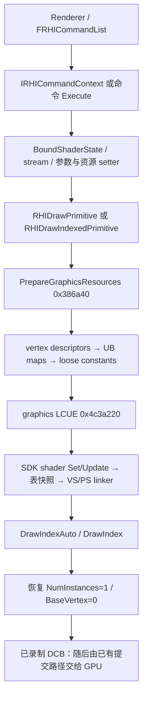

# KH3 GnmRHI：UE graphics/draw、shader 绑定与 graphics LCUE 还原

本文延续 [UE 关联参考](kh3-gnmrhi-ue-reference.md)，语义目标仍是 **KH3 CUSA15072 01.10，`++UE4+Release-4.17`**。这次补通普通 **VS/PS → vertex fetch → UB/资源 → graphics LCUE → direct draw** 的主要状态关系，并提供 [GnmGraphics.cpp](../../tools/gnmrhi-semantics/ue4-reference/GnmGraphics.cpp)。它使用真实 UE 类及 override；可独立编译测试的算法放在同一实现使用的 [GnmGraphicsCore.h](../../tools/gnmrhi-semantics/ue4-reference/GnmGraphicsCore.h)。不是完整 PS4 RHI 模块或原厂源码。

## 1. 证据、版本和可复查范围

所有地址均为 eboot **模块偏移**，不含运行时 load base `0x400000`。

| 材料 | 身份 / 使用边界 |
|---|---|
| 原始解密 ELF | SHA256 `29524c8302995aac8207e69b3e16da81410bce4685d9b010d011c3dec72990b9` |
| 兼容补丁运行时 ELF | SHA256 `be1ff228eecdb3bcd327a637dd538426c916eb4514cbe4b522f2461fc38e4a8d`；本轮没有运行它 |
| Reverse Study 工作区 | `kh3-gnmrhi`，模块 eboot，imagebase 0，439113 functions |
| 使用的 review.i64 | `build/validation/kh3-gnmrhi-20261016/ida-snapshots/20261016-025014-950ff7e61114485dbee9476d7e376c2f/review.i64` |
| IDB 文件 SHA256 | `8b6017a85577ff8ae1b4e6c480777e967325fe712c77819e6136cd8bab0728a1`；这是数据库文件身份，不能作为原始 ELF SHA |
| 完整伪码 | `build/validation/kh3-gnmrhi-20261016/decomp/graphics-382bf0.cpp`、`graphics-4c3a220.cpp`、`graphics-381550.cpp`、`graphics-380f90.cpp`；后者是 indirect indexed，不能误认成 direct |
| 原始指令 | 同目录 `static/fn_<offset>.asm.txt`，带原始 ELF SHA 与 `.eh_frame_hdr` 函数范围；关键字段、寄存器、栈参数另以指令核对 |
| UE 接口校对 | 本地 UE 4.18-GameWorks `b50e6338a7c5b26374d66306ebc7807541ff815e` 的 `RHIContext.h`、`RHICommandList.h`、`RHIResources.h`。只用于公开接口关联，不据此声称 KH3 是 4.18 |

本轮没有使用设备，没有 GPU capture / 差分执行，没有向 IDA 强制导入不匹配 SHA 的符号。新名称和字段仍是 **candidate**。shader 创建、反射序列化、完整 GS/tessellation 状态尚未恢复；不能把普通 VS/PS 主路径等同于整个 graphics 后端。

## 2. 接回 UE：哪些是接口，哪些是 Execute 和 SDK helper



| UE 语义入口 | KH3 偏移 | 已核对的关联 |
|---|---|---|
| `RHISetBoundShaderState` | `0x382bf0`；thunk `0x384390` | thunk 对 this 减8后跳转，符合 `IRHIDeprecatedContext` 子对象；不能在完整 context 上重复减8 |
| graphics pipeline fallback | `0x37f220`，关联候选 | 调候选 BSS factory `0x3bace0`，再 BSS/depth/raster/blend；**还使用 EDX 的 stencil-ref 低字节**，不是 stock 4.18 单参数虚方法的逐参数同一实现 |
| `RHISetStreamSource` | `0x37e180` | ctx、StreamIndex、VB、Stride、Offset，分别 RDI/ESI/RDX/ECX/R8D |
| `RHISetShaderUniformBuffer(VS/PS/GS)` | `0x369400 / 0x36a130 / 0x369da0` | 常量当场绑定，原 UB 引用和 UE stage dirty 延迟供 map 展开 |
| VS/PS loose parameter command Execute | `0x368f40 / 0x369340` | RDI=command，RSI=command list；读 list+20/context 与 payload，转入 `0x368f70`；不是 public setter 参数 ABI |
| VS/PS texture command Execute | `0x36a840 / 0x36ae00` | command+10 shader、+18 bind index、+20 texture；texture null 直接返回 |
| VS/PS sampler command Execute | `0x36c4d0 / 0x36c8b0` | sampler descriptor 在对象+14，4 dword；mapping 未用时不读 sampler |
| VS/PS SRV command Execute | `0x36b0c0 / 0x36be30` | 转 `0x36b0f0`；VS stage 取 shader+380，PS 固定1；null SRV 不清槽 |
| `RHIDrawPrimitive` | `0x380650` | RDI ctx，ESI topology enum，EDX base vertex，ECX primitive count，R8D instances |
| `RHIDrawIndexedPrimitive` | `0x381550` | ctx/IB/type/base/first-instance/NumVertices 在六个寄存器；StartIndex、NumPrimitives、NumInstances 在 entry RSP+8/+10/+18（十六进制）；NumVertices 未使用 |
| graphics LCUE commit | `0x4c3a220` | RDI=`GNM+0x2e8`；7 个真实调用者均为 draw 家族，无须把 data xref 当调用 |
| PS input control emitter | `0x68bb930` | cmd buffer、control table、count；`SET_CONTEXT_REG` 从 `0x191` 开始 |

UE 4.18 的 `RHIContext.h:337` 正好给出 fallback 的结构：创建/取 BSS，设置 BSS，再设 fixed state。因此 **PSO → BSS → Gnm shader state** 有公共 UE 对照，不能因为二进制中有一层 pipeline wrapper 就把它说成现代 UE5 的完整原生 graphics PSO。

另一个版本标记：KH3 的四参数 stream setter 明确使用 stride；4.18 `RHICommandList.h:2849` 将该重载标为 deprecated，并另有三参数形式。参考实现保留 KH3 四参数形式，不靠新接口猜 stride 来源。

## 3. BSS、shader 选择与 dirty 状态

`0x382bf0` 从 BSS 读取：

| BSS 偏移 | 语义 |
|---|---|
| `+48` | fetch shader 指针 |
| `+180` | 每个 declaration element 的 int32 remap；负数跳过 |
| `+190` | VS modifier |
| `+198` | vertex declaration |
| `+1a0` | 一个共享寄存器写入的原始源值 |
| `+1a4 / +1a7 / +1a8` | VS/PS/GS 使用 loose constants 的字节标记 |
| `+1b0 / +1b8 / +1c0` | VS/PS/GS shader 对象 |

普通 VS 的 program 在 shader+1d8，reflection 内嵌于 shader+b0；同时把 fetch shader 与 modifier 交给 LCUE。PS 的 program/reflection 同样采用这两个偏移，PS 可以为空。VS setter 使用的 shader+380 是 **GNM hardware stage**，并非 UE 的 `EShaderFrequency`。

本函数会：

1. 设置 context+ab4 vertex-descriptor dirty 和 +ab5 discard-old-loose-extent。
2. context+aa8 安装 declaration，+448 持有当前 BSS；另向 +b30 起的 2500 项 history 环写入引用，+5950 为 cursor。该环只是这里看见的 CPU 引用保留，**不是 GPU 完成证明**。
3. 将 VS/HS/DS/PS/GS 的五个 UB dirty mask（+908…+918）全部设为 `0xfffff`。这与此前 CS setter 没有写 all-UB-dirty 的行为不同。
4. LCUE resources dirty 重标；shader dirty 累积 `oldProgram != newProgram`。**没有把 loose shadow dirty 本身设1**。discard extent 只影响下一次真正发生的上传。

选择 SDK `Update*Shader` 还需同时满足：旧/新 program 非空、shader dirty、该 stage 的 emitted bit 已设置、关键寄存器字相等。

| Stage | 比较的 native program 字段 |
|---|---|
| VS | DWORD +18、+1c、+20 |
| PS | DWORD +18、+1c、+20、+24、+28、+2c、+30、+34 |

选择时会清该 stage 的 emitted bit；LCUE 真正录入 shader 时才重设。因此 **连续选两次 shader 而中间未 emit** 会失去 Update 资格，不能仅比较“当前与新 shader 的资源使用量”。`Selection` 的测试专门覆盖这一点。

其余 side effects 在 `ApplyGraphicsSelectionSideEffects` 留为必须实现的平台边界，包括旧 GS 模式清理、ring/resource 处理、pending PS 资源追踪。已读出的普通寄存器动作是：shared word 非零时写 context register `0x1ba`，值 `((word<<12)&0x1fff000)|0x240`；PS enable 改变时写 `0x202` 为 `0xcc0010` 或 `0xcc0000`。PS reflection+d 有 selector 时，raw scalar D 取 `4 * context[+420]`。不能因为有这几个包就把剩余资源处理填成空方法。

## 4. Stream → vertex fetch descriptor

**纠正 r3 部分布局：context+928 是 stream0 的 GPU 地址，不是 vertex declaration。真正 declaration 指针在 +aa8。** 已修正原符号分片，同时增加专门的 graphics overlay。

stream 数组从 +928 开始，16 项，每项24字节，正好到 +aa8：

| 项内偏移 | 内容 |
|---|---|
| +0 | `currentBacking + Offset`，uint64 |
| +8 | `bufferSize - Offset`，uint32 |
| +c | Stride，uint32 |
| +10 | `Stride ? RemainingBytes/Stride : RemainingBytes` |
| +14 | 本路径未识别 |

VB RHI 指针在二进制中先减 `0x68` 到 multibuffer 对象，再按 volatile/current-slot 取 backing。**地址在 SetStreamSource 执行时快照**；之后 Lock 轮换不会自动重解析该 stream。index draw 的 backing 则在 draw 执行期间解析，buffer SRV 在绑定/展开时刷新，这三种读取时机需要区分。参考 `TRefCountPtr` 不是对这些 GPU 地址寿命的兜底，仍需平台分配器保留旧 backing。

`0x386a40(ctx, FirstInstance)` 比较 +ab0；FirstInstance 改变或 vertex dirty 时重建。declaration 的 element 数组在 +14，步长8，count 在+94。读出的 element 字段是 stream byte0、offset byte1、type byte2、stride WORD4、per-instance WORD6；remap 来自 **BSS 的数组**，不能用 element byte3 直接代替。

每个有效 element：

```cpp
Address = Stream.Base + Element.Offset
        + (Element.PerInstance ? uint32(FirstInstance * Element.Stride) : 0);
D[0] = low32(Address);
D[1] = ((Address >> 32) & 0xfff) | ((Stream.Stride << 16) & 0x3fff0000);
D[2] = Stream.NumRecords;
D[3] = (16*Format & 0x7000) | Extra | (Format >> 12 & 0xfff) | 0x20000000;
```

`Format` 来自 `0x7eb9600` 的19项表，Type-1 索引；完整值和 Extra 位运算保存在共享 C++ core。注意地址增加的是 **element stride**，descriptor 编码的是 **stream stride**；实例偏移乘法是32位。记录数没有额外减去 element/instance offset，也不凭常识改成 NumInstances。

描述符通过当前 vertex hardware stage 的 `reflection+ea+2*remap` 路由。`ffff` 未用、bit15 直接 SGPR、低14位索引与 compute 相同；未用映射也会置 resources dirty。负 remap、空 stream 则在更早处跳过。

## 5. 常量、texture/SRV/sampler 与四种 dirty

普通 draw 的准备顺序为 **vertex descriptors → VS/PS/GS resource maps → graphics loose upload**。资源 map 仍是 UE `FRHIResourceTableEntry` 的8/16/8打包格式，texture/SRV/sampler 各有自己的 UB-prefix 数组，不能共用一个起点。

| 状态 | 写入者 / 消费者 |
|---|---|
| UB dirty | setter 写单槽，BSS setter 写五阶段 `0xfffff`；draw 前按 shader `ResourceTableBits & Dirty` 展开，然后清 mask |
| loose dirty | parameter writer 写 shadow、记录 UpdatedEnd；`0x386680` 按 BSS 的 used flag 上传成功后清 dirty/UpdatedEnd |
| LCUE resources dirty | vertex、UB 常量、直接/展开资源绑定以及 BSS setter；graphics LCUE 复制 staging 与发 pointer/scalar 后清 |
| shader dirty / UpdateAllowed | BSS program 选择；LCUE SDK Set/Update 后清；与 resources dirty 不同 |

UB setter 当场用当前 reflection 的 constant map 绑定常量，null/zero-constant UB 仍取已恢复的全局默认 UB 的常量部分；UE slot 保存原 UB。resource-only UB 的资源仍能在 draw 时展开。VS hardware stage 从传入 shader+380 读取，PS=1、GS=3。

直接 texture/SRV 的 null 在已读路径是 no-op，**不是写零 descriptor，也不是清 texture cache**。sampler 在 mapping 未用时只标 dirty，不解引用 sampler；有效映射读取对象+14的四 dword。texture 是八 dword；buffer/texture SRV 的四/八 dword与 backing 更新由 `0x36b0f0` 处理。`ResolveDescriptor` 适配器必须包含 texture reference、动态 SRV 和未恢复分支的拒绝处理，不只是把对象地址当 descriptor 地址。

图形 loose 从 context+ac0(VS)、+ad8(PS)、+ae0(GS) 获取。是否使用由 BSS +1a4/+1a7/+1a8 决定；constant slot0绑定到 vertex current stage / PS1 / GS3。BSS 切换后的第一次**脏上传**可丢弃旧 extent；没有新参数写入时不能凭 discard 标记制造上传。`0x386680` 尾部始终清 context+ab5。

## 6. Graphics LCUE 的正常 VS/PS 路径

下表一律以 **LCUE base = GNM+2e8** 为基址；若用完整 GNM 地址必须再加2e8。

| LCUE 字段 | 已恢复含义 |
|---|---|
| +20 / +30 | upload cursor / end |
| +90 +1800×stage | CPU staging prefix |
| +c090 | DCB command-buffer object |
| +c0a0 +8×stage | native program pointer |
| +c180 +8×stage | reflection pointer |
| +c248 / +c250 / +c258 +stage | shader dirty / resources dirty / UpdateAllowed |
| +c260 | graphics mode，bit20h 为 ES/GS 分支，bit0 为 LS/HS 分支 |
| +c264 / +c266 | emitted shader mask / active-stage flags，两个不同字段 |
| +c1c0 | cached PS input-control table；BSS setter 清空 |

stage 为 **CS0、PS1、VS2、GS3、ES4、HS5、LS6**。正常路径先处理 VS shader，再 PS shader，再 VS table，再 PS table，最后才做 VS→PS linker。shader 发包不是每个 descriptor setter 都调用：

- VS：`SetVsShader` 或 `UpdateVsShader`，reserve29 dword，native header+8 和 BSS modifier。
- PS：`SetPsShader350` 或 `UpdatePsShader350`，reserve40 dword，header+8，null PS走有意解绑。
- 开启 prefetch 时，shader 后追加预取；原始包包含 `c0055000,60000000,...`，保留为 SDK adapter 责任，不把程序地址当成 shader code 地址。
- resource dirty 时，按 reflection DWORD数上传一个**新表快照**（4字节对齐），然后把它和子表地址写入 SGPR。之后修改 CPU staging 不应影响已录入的旧表。

### 全部普通 VS/PS selector

`0xff` 表示不存在。以下顺序与读到的普通分支一致：

| reflection 字节 | VS/PS 写入内容 | 数据形式 |
|---|---|---|
| +7 | 新表 base | 2 dword 地址 |
| +8 | base +4×WORD(+16) | 2 dword |
| +9 | base +4×WORD(+1a) | 2 dword |
| +a | base +4×WORD(+1c) | 2 dword |
| +b | base +4×WORD(+1e) | 2 dword |
| +c | LCUE+78 的共享指针 | 2 dword |
| +d | LCUE+c0e0+4×stage 的 raw scalar | marker +1 dword |
| +e | LCUE+c100+4×stage 的 raw scalar | marker +1 dword |
| +4，仅VS | LCUE+c130 fetch shader | 2 dword |
| +5，仅VS | base +4×WORD(+18) | 2 dword |
| +6，仅VS | base +4×WORD(+20) | 2 dword |
| +f，仅VS | WORD(LCUE+c6e8) × WORD(LCUE+c6ea) | marker +1 dword |

普通 PS 分支**不消费 +4/+5/+6/+f**。这些 selectors 不能依照排列顺序全当成同类表指针。core 使用 `SharedPointer` / `ScalarD/E/F` 原始名称，未给未闭合字段编造 UAV count、scratch size 等业务语义。

graphics `SET_SH_REG` header 为 `c0007600 | (count<<16)`，PS/VS 的包内 register offset 基址是 `0x0c / 0x4c`。带 marker 的直接 descriptor 或 scalar 前有 `c0001000,6875000d`；64位 pointer 写无此 marker。与 compute 的 `...7602` 要区分。

末尾清 PS/VS 的 resource、shader、update 三组字节。这里叫 commit 是“将缓存状态录到 DCB”；**没有 `sceGnmSubmitCommandBuffers`/SubmitDone/flip**，底层真实队列提交沿用[提交与回收篇](kh3-gnmrhi-reconstruction.md)。

### GS / tessellation 已读到哪里

mode&20h 时先处理 ES+GS，mode&1 时先处理 LS+HS，再进入正常 VS/PS 公共尾部。BSS 的 GS 路径使用 VS+260 alternate ES program、VS+268 alternate reflection、GS+1d8 program；vertex hardware stage 变4，mode写b0h。还涉及 copy shader、ring/streamout、GS allocator 和 `0x4c3dd50 / 0x4c3e010`；LS/HS 分支包含额外 tess 参数与 reflection+e8 周围字段。**本轮没有完成这些生命周期与参数来源的闭环**。C++在 BSS 入口拒绝 GS/tess，而不是把普通 VS 的 table commit 套到所有 stage。

## 7. VS→PS 语义 linker

只有 VS 或 PS shader dirty 且两个 program 都存在、PS input count非零时生成/复用输入 control 表：

- VS semantic count：program byte+25；表地址 `program + 4*(byte[3] + 10 + byte[24h])`。
- PS semantic count：program byte+38；表地址 `program + 4*(byte[3] + 15)`。
- **byte[3] 是单字节，不是 DWORD[3]**。每项是16位，低8位 semantic ID；PS输入逐项找第一个同 ID 的VS输出。
- base模式中，命中取VS项高字节低5位为 offset，并并入PS的插值控制位；未命中 offset=32，再合PS的+8/+9位。不是简单按数组下标对齐。
- Neo且PS项高2位非零时，按PS高2位与VS高字节高2位计算 Mode，设置 `0x80000` 和另外的模式/默认值控制位；未命中分支也有独立规则。全部位运算已在 `LinkPixelInput` 保留并测试。

结果由 `0x68bb930` 发 `c0006900|(count<<16), 0x191, controls...`，即 SPI_PS_INPUT_CNTL 数组。参考每次 dirty 时重算，未实现可复用的内部 cached-table存储；BSS selection本来就会使其失效，因此不改变已覆盖路径的结果。shader loader 必须给参考对象提供原始 semantic WORDs，不能拿 UE 属性位置代替这些 shader 输出/输入标记。

## 8. direct draw 的包顺序与地址时机

`RHIDrawPrimitive`：

```text
PrepareGraphics(FirstInstance=0)
→ topology（若变）→ base vertex（若变）→ instances（若变）→ index type=0（若变）
→ graphics LCUE
→ sceGnmDrawIndexAuto(count, GNM[+28]&1)，reserve7 dword
→ instances恢复1（若需）→ base vertex恢复0（若需）
```

`RHIDrawIndexedPrimitive`：

```text
StartIndex × (raw index type !=0 ? 4 : 2)，32位乘法
→ PrepareGraphics(FirstInstance)
→ topology → instances → index type → base vertex（均按缓存比较）
→ 解析 index buffer 当前 backing + 上述 offset
→ graphics LCUE
→ sceGnmDrawIndex(count, address, GNM[+28]&1, 1)，reserve10 dword
→ instances恢复1 → base vertex恢复0
```

公共包分别为 topology=`c0017900, Neo?10000242:242, value`；base=`c0016800,8102,value`；instances=`c0002f00,value`；index type=`c0002a00,raw&fffffb3f`。draw后的恢复不清 topology/index-type缓存。

普通 direct 路径闭合的拓扑是 UE TriangleList0→GNM4、TriangleStrip1→GNM6、LineList2→GNM2，顶点/索引数为3N、N+2、2N。通用 UE count helper还能算point/patch，GNM转换却对这些值走assert；Quad在count helper又走assert。因此参考版只接受三个交集，不能因见到硬件表里的19就宣称 Quad/Point/Patch已经支持。

## 9. 代码、验证与后续游戏复用

| 文件 | 本轮实现 |
|---|---|
| [GnmRHIReference.h](../../tools/gnmrhi-semantics/ue4-reference/GnmRHIReference.h) | 增加14个 graphics override，仍继承真实 `IRHICommandContext` |
| [GnmGraphicsTypes.h](../../tools/gnmrhi-semantics/ue4-reference/GnmGraphicsTypes.h) | `FRHIVertexShader/PixelShader/VertexDeclaration/BoundShaderState` 派生对象、stage/stream/BSS状态 |
| [GnmGraphics.cpp](../../tools/gnmrhi-semantics/ue4-reference/GnmGraphics.cpp) | UE setter、UB maps、vertex/loose准备、normal LCUE、两种 direct draw |
| [GnmGraphicsCore.h](../../tools/gnmrhi-semantics/ue4-reference/GnmGraphicsCore.h) | C++14共享的 vertex packing、semantic linker、Set/Update判定、descriptor/table PM4、draw缓存状态 |
| [UECallSite.cpp](../../tools/gnmrhi-semantics/ue4-reference/UECallSite.cpp) | 真实 `FRHICommandList` graphics 示例；pipeline/BSS factory与render targets由调用者提供 |
| [graphics_tests.cpp](../../tools/gnmrhi-semantics/cpp/graphics_tests.cpp) | 直接编译上述共享core，没有重写一份UE替身来测试 |

验证结果：MSVC19.51 Debug构建通过；CTest **2/2**，原13个语义场景及新增6组graphics场景通过。新增覆盖stream地址/记录数、per-instance偏移、普通/Neo linker、连续shader选择、direct/table/unused映射、新旧table快照、全部normal selectors、draw状态恢复。测试中的固定包字、format位和布局来自已读指令；这不是二进制差分验证。

接口检查器比较 **24个 override** 与保存的原始UE通用头文件，报告 `build/validation/kh3-gnmrhi-20261016/ue-reference-interface-check-r5.json`。**完整 UE 文件尚未在 UE/PS4 SDK 工程编译**；这些检查不验证 `GnmGraphics.cpp` 的完整引擎集成，也没有验证设备画面。参考中的 `check`/`assert` 防误用要求开启，Shipping不在验证范围。

符号包新增 [gnmrhi-graphics.symbols.json](../../guest/games/CUSA15072/01.10/symbols/gnmrhi-graphics.symbols.json) 的18个条目、9个部分类型，给先前3个候选函数补原型并纠正+928字段。[index.json](../../guest/games/CUSA15072/01.10/symbols/index.json) **revision5：84 symbols、65 typed、30 types、5 shards**。prepare dry-run及实生成通过，生成目录 `symbols-generated-r5/`；clang `x86_64-none-elf` 通过285个size/offset断言及生成C语法检查。原始ELF、兼容runtime与分片SHA均校验通过。

用于另一个 UE PS4 游戏时，优先寻找：DrawIndex* caller → 资源准备 → `ffff/8000/3fff`映射 → `0x1800`stage staging → shader Set/Update与PS输入匹配。然后验证其独立ELF、硬件stage路由、stream快照时机、UB容量、反射offset和dirty清零关系。**可复用的是代码结构与识别方法，KH3固定offset、表常量、SGPR布局必须重新确认。**

r6已继续补[GS/ES、copy shader/ring与LS/HS](kh3-gnmrhi-stages.md)，包含UE GS绑定实现、SDK tess提交重放及100符号的索引。本篇验证数字保留为r5历史结果。剩余缺口是UE HS/DS选择与patch draw、tess factor backing、shader blob loader、UAV/texture状态变化及真实SDK/分配器适配；静态结果不改变尚未定位的闪黑结论。
