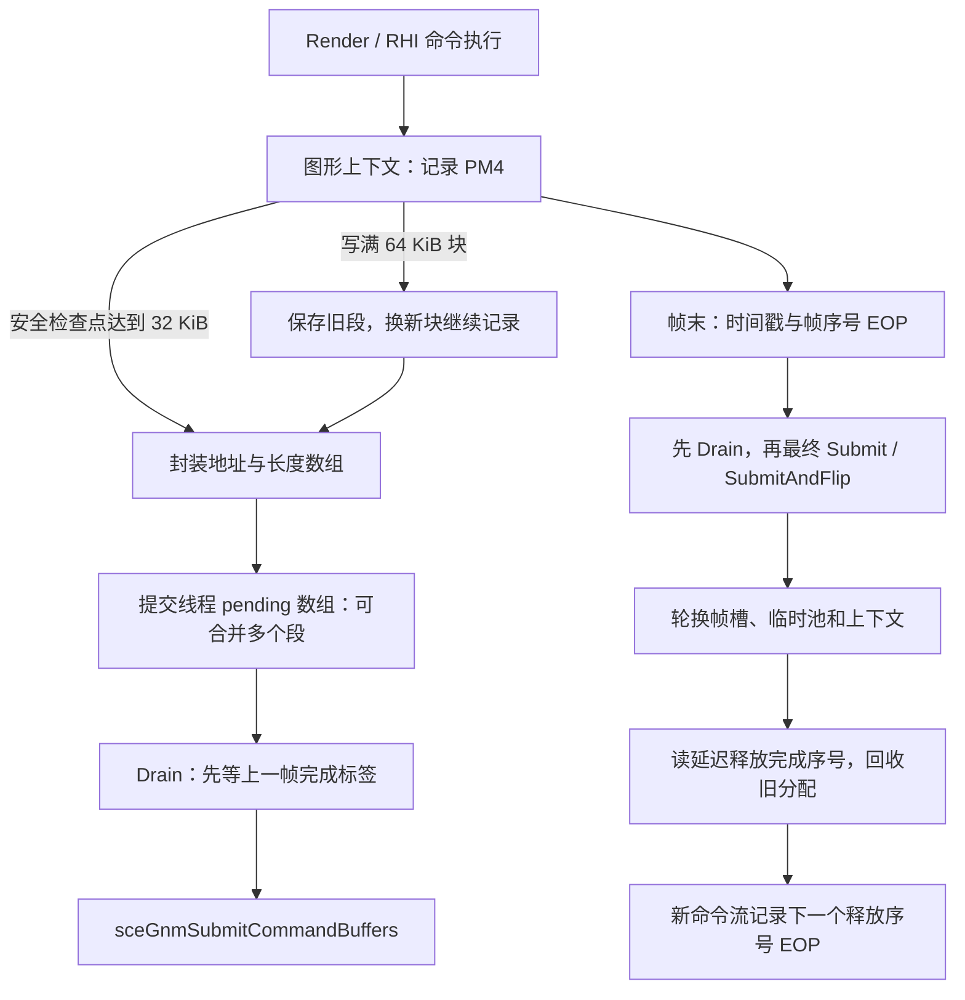

# KH3 01.10 的 GnmRHI：提交、缓冲与回收实现还原

本次以 **CUSA15072 01.10 的实际 eboot，UE `++UE4+Release-4.17`** 为依据。目标是还原这个游戏分支的工作方式；4.18 公开 RHI 代码只用于解释枚举和接口，不替代二进制证据。不能据此声称恢复了 Epic 原版 4.17 的全部 PS4 源码。

分析日期：2026-10-16。起点是[静态分析交接](../handoffs/kh3-gnmrhi-ida-20261016.md)。本轮没有操作 Odin3，也没有采集新的运行时样本。新符号均标 `candidate`：指令行为可核对，语义名称是还原名，没有冒充厂商符号或运行时验证。

后续深入结果见[参数、资源绑定、LCUE 与 dispatch 语义](kh3-gnmrhi-binding-semantics.md)，补有可运行模型、描述符表快照和跨游戏识别方法。本文所述 revision 2 为首轮记录；当前符号索引已更新至 revision 3。

## 1. 证据和地址

- 原始解密 ELF：`build/validation/odin3-kh3-preempt-20261012/kh3-exe-parent/export/app0/elf/eboot.bin.elf`。
- SHA256：`29524c8302995aac8207e69b3e16da81410bce4685d9b010d011c3dec72990b9`。
- 兼容的已有运行时身份：`be1ff228eecdb3bcd327a637dd538426c916eb4514cbe4b522f2461fc38e4a8d`，来自现有符号索引，本轮未重新验证设备。
- 下文地址均为 **eboot 模块偏移**。已知会话的加载基址为 `0x400000`，不能把 ELF 文件偏移或分析 ELF 的 IDA 基址直接当运行时地址。
- 函数边界取 `.eh_frame_hdr`；正文依据逐条 x86-64 反汇编、直接调用、重定位和数据初值。原始输出在 `build/validation/kh3-gnmrhi-20261016/static/fn_<offset>.asm.txt`，每份带原始 ELF SHA。
- 用 `tools/ps4-guest-code/ps4_guest_code.py` 可重查；本地批量取证辅助脚本为同目录的 `inspect_kh3.py`。IDA 首次打开超时，后续成功得到 `kh3-gnmrhi` 工作区（imagebase=0，439113 个函数）；用 Hex-Rays 复核了多缓冲构造 / Lock、SubmitDone worker、query Begin / End 和 SDK 发包 helper。部分自动原型有噪声，以指令和调用点为准。
- 可直接重开的 IDA 快照：`build/validation/kh3-gnmrhi-20261016/ida-snapshots/20261016-025014-950ff7e61114485dbee9476d7e376c2f/review.i64`。快照 SHA256 `8b6017a85577ff8ae1b4e6c480777e967325fe712c77819e6136cd8bab0728a1`；其输入是 ET_DYN 分析 ELF（SHA256 `68c4daa352c94c2eff90f9d92e2c6fe401b029b6a612ba84d9c7104aa59f3866`），与原始 ELF 的 SHA 不同。不要为方便导入而放宽符号包的原始 SHA 门禁。
- 可复用名称、原型和部分布局写入 [v2 符号索引](../../guest/games/CUSA15072/01.10/symbols/index.json)，而非只保存在本文。

## 2. 当前已经补出的模块关系



这里有四种独立计数，不能统一叫“双/三/四缓冲”：

| 对象 | 数量 / 规则 | 真正用途 |
|---|---|---|
| 非 Volatile 的普通 Dynamic buffer | 3 份，每次写 Lock 轮换 | CPU 写入与先前引用的分离 |
| 临时分配器前端 | 2 个 bank，producer / consumer 分别选 bank | Render/RHI 命令交接时的临时分配 |
| 大块池 | 4 个 generation bin；闲置差值 ≥6 才申请释放 | 跨帧复用 64 KiB / 512 KiB / 8 MiB backing |
| 提交完成标签 | 2 个指针槽，值是帧序号 | 提交推进门槛；不是用槽数直接推导 GPU 落后帧数 |

## 3. continuous submit 与帧末流程

### 3.1 切段、封装、合并、提交是不同步骤

`r.PS4CommandBufferSplitSize` 初值为 32768。`0x3881e0` 的 `0x38822c–0x388242` 比较当前 DCB 写指针与该段起点的字节差；只有上下文相应标志开启并到达这个检查点才执行。达到阈值后在 `0x388889` 调 `0x372930` 封装，在 `0x388898` 调 `0x372b20` 排队。因此 **32 KiB 是切段检查阈值，不是硬长度上限，也不是每 32 KiB 恰好一次 syscall**。

`0x372930` 把尚未封装的尾段加入地址 / 字节数数组，把数组复制进 batch，然后令 `chunkStart = currentWritePointer`。复制的是数组元数据，没有复制 PM4 载荷。batch 的已识别布局：

| 偏移 | 内容 |
|---|---|
| `+0x000` | 内联 sizes[32]，每项 uint32 字节数 |
| `+0x080 / +0x088 / +0x08c` | sizes heap 指针 / count / capacity |
| `+0x090` | 内联 addresses[32]，每项 uint64 |
| `+0x190 / +0x198 / +0x19c` | addresses heap 指针 / count / capacity |
| `+0x1a0` | 16 字节元数据，成员语义未完全确定 |

`0x372b20` 持提交 worker 的锁操作 pending 数组。如果已有 pending batch，会把新数组内容合并到最后一个 batch，再唤醒事件。这里看不到 64 段上限。它解释了为什么 32 KiB 自动拆分仍能形成一次 72 个 DCB 的提交，也说明实际 syscall 粒度随消费者调度变化。与此前 Android 64 项硬限的修复一致，但本轮没有重新复现 72 项提交。

`0x39ac00` 初始化命令上下文时取得 **64 KiB** 块。溢出回调 `0x3870f0`：

1. 将旧块当前未封装范围的地址和长度加入上述数组；
2. 从块池取得 / 复用下一块；
3. 更新 base、current、end 和 chunkStart，继续往新块记录。

已读路径采用提交数组拼接，没有找到通过 `REWIND` 或回改旧段来链接这些块的操作。这个否定只覆盖本次读过的切段 / 溢出 / submit 路径，不能外推到全部 SDK 调用或游戏代码。载荷以指针交出，模拟器仍需保证异步消费期间的数据寿命。

### 3.2 两个后台线程的分工

交接稿中的 `0x39cbb0` 应更准确地称为 **DrainQueuedSubmissions**：它是 drain helper，既由后台线程调用，也由最终提交调用；实际线程 Run 是 `0x3a8370`。

| 函数 | 已读行为 |
|---|---|
| `0x3a8370` | `PS4ContinuousSubmits != 0` 时等 worker 事件，再调用 `0x39cbb0`；关闭时每轮睡约 16.659 ms，后台不做该 drain |
| `0x39cbb0` | pending 转入消费数组；检查上一帧标签；按需 SubmitDone；提交 graphics / compute；清空消费数组和事件 |
| `0x39c920` | 先调用 drain，再对最终 batch 调 SubmitAndFlip 或普通 Submit，清除 finalPending |
| `0x3a8b50` | SubmitDone worker；200 ms 周期检查，相关 pending 状态成立且距上次调用超过 1 s 时补 SubmitDone |

graphics 提交点 `0x39d152` 的两个 CCB 参数均置零；最终提交的 CCB 参数也为零。它与已有 16 帧 trace 的 CCB=0 相互支持。compute 在 drain 的另一组数组中处理，不能因为 CCB=0 就说没有异步 compute。

### 3.3 提交门槛是前一帧 EOP 的值

管理器 `G = 0xa7260e0`。`0x39cffe–0x39d021` 的实际条件可写成：

```cpp
int previousSlot = 1 - G.submitSlot;     // G + 0x1ec
int32_t previousFrame = G.frameSerial - 1; // G + 0x2c8
while (*G.frameDoneLabel[previousSlot] != int64_t(previousFrame)) {
    if (PS4EventBasedFrameEnd)
        sceKernelWaitEqueue(...);       // 超时参数初始化为 60000，醒来仍复查标签
    else
        scePthreadYield();
}
if (G.lastSubmitDoneFrame != previousFrame)
    sceGnmSubmitDone();
submitQueuedBatches();
```

两槽地址在 `G+0x200`，不是标签本身；先读指针，再读 64 位标签。等待循环不是“收到一个事件就算完成”。此处明确限制的是 **新一轮提交必须先见到前一帧标签**，无法仅用两槽推出 RenderThread / GameThread 可提前几帧。

`0x39ec20` 帧末在 `0x39ee9f–0x39ef15` 编入 `EVENT_WRITE_EOP`：header `0xc0044700`、event `0x504`，高地址字 OR `0x42000000`，payload 为当前帧序号。这是向内存写 64 位值并带中断选择的包。它之前还记录 GPU 时间戳（data_sel=4）。然后最终提交、递增序号、轮换 slot。

**SubmitDone 与 flip 不是固定紧邻的一对调用**：`0x39c920` 先 drain，之后才最终 SubmitAndFlip；最终提交后设置 SubmitDone worker 的 pending 状态。下一轮 drain 和超时 worker 都可能承担 SubmitDone。不能写成“每帧 flip 返回后立即同步 SubmitDone 并等 GPU”。

## 4. FGnmMultiBufferResource 与 Lock

`0x3a3010` 接收 `RDI=self, ESI=size, EDX=usage`。usage 分支存在优先级：

| 条件，按执行顺序 | 份数 | 分配 / 轮换 |
|---|---:|---|
| `usage & 0x4`（Volatile） | 1 个槽 | 构造时不分配数据；每次写 Lock 取新临时区 |
| 否则 `usage & 0x9`（Static 或 UAV） | 1 | 独立 backing |
| 否则 `usage & 0x2`（Dynamic） | 3 | 三份独立 backing |
| 都没有 | 断言后 fallback 1 | 断言来自 GnmMultiBuffer.cpp:194 |

尤其 **Dynamic | UAV 命中的是单份分支**，不能只根据 Dynamic 位断言三份。普通非 Volatile 分配先按 1 KiB 对齐；≤32 KiB 走 small allocator，较大分配按 64 KiB 对齐。`usage&0x400` 影响 memory-kind，尚未把该枚举映射到 Onion/Garlic，本文保留数值含义。

核心部分布局：

| MultiBuffer 偏移 | 内容 |
|---|---|
| `+0x18` | 1 个内联 slot，stride `0x38` |
| `+0x50 / +0x58 / +0x5c` | heap slots / count / capacity |
| `+0x60` | uint16 currentSlot |
| `+0x62` | 分配条件标志，具体用途未定 |
| `+0x63` | isVolatile |

slot 的 `+0x08` 是 parent、`+0x10` 是 index；`+0x18` 为 data 指针，`+0x20/+0x24` 为逻辑 / 分配大小，`+0x28` 为 allocator metadata，`+0x30` 为 memory-kind。

`0x39a100` 的 Lock 行为足够小，可完整表达：

```cpp
void* Lock(MultiBuffer* b, uint32_t mode, uint32_t offset) {
    if (mode != 0) { // WriteOnly；mode 0 对照 ReadOnly
        if (b->isVolatile)
            b->slots[0].data = AllocateTransient(b->slots[0].size);
        else
            b->currentSlot = (b->currentSlot + 1) % b->count;
    }
    return currentData(b) + offset;
}
```

这里 **每次写 Lock 轮换**，没有按帧号判断、没有在 Lock 内等 fence。连续超过三次写锁可以绕回原槽；上层调用节奏是否保证安全，不能靠这段 helper 单独证明。`0x3cbe90` 的 vertex Lock 包装把 RHI 指针减 `0x68` 交给它，`0x3cbeb0` 的 Unlock 直接返回。

因此，资料中的“Dynamic 每帧一份、同帧再写就覆盖”不能直接作为本 KH3 的内部实现描述。它可作为 UE API 使用约束，但本二进制的精确操作是上述逐 Lock 轮换；UAV 和 Static 又各有例外。

## 5. Uniform buffer 和临时块寿命

### 5.1 创建时复制，不是保留上层输入指针

`RHICreateUniformBuffer` 包装 `0x391d20` 构造 `0x68` 字节对象，调用 `0x3a3ce0`。后者的参数为 `RDI=self, RSI=contents, RDX=layout, ECX=usage`。

- `layout+0`：constant bytes；`layout+4`：contents 内资源表偏移；`layout+0x10`：资源数。
- usage ≤1 走 `0x36b620` 临时分配器；usage >1 走独立分配（小块按 16 字节对齐、较大按 64 KiB）。与 SingleDraw=0 / SingleFrame=1 / MultiFrame=2 的公开枚举对应，但执行条件直接来自 KH3。
- 常量大小非零时把 contents **复制**到新 backing，再建立 16 字节 GNM descriptor；不是 descriptor 直接引用 contents。
- 包装函数另复制资源指针表，并增加各资源的引用计数。不能只追常量地址而忽略引用的纹理 / SRV。

对象 `+0x18` 为 layout，`+0x20/+0x28/+0x2c` 为资源指针数组 / count / capacity，`+0x30` 为 allocation descriptor，`+0x50` 为 GNM descriptor，`+0x60` 为 constantSize。GNM descriptor 的记录数是 `ceil(size/16)`，尾字为 `0x20077fac`。

本轮没有识别到 KH3 的独立 `RHIUpdateUniformBuffer` 实现；创建路径支持“新建并复制”的模型。**这不等于全二进制不存在任何原地写入常量的内部路径**。后续应从 uniform 绑定点追到该帧用的 descriptor，再看其 backing 的实际写入者。

### 5.2 临时分配器：1 KiB 对齐、8 MiB 块、两个 bank

`0x36b620` 将请求向上对齐到 1024 字节；单次超过 `0x800000` 会按失败模式断言 / 返回空。容量不足则切下一个 8 MiB 块，不是在当前块尾部直接绕回头部。

bank 选择与线程身份有关：线程等于 `0xbaefd20` 中的线程标识时选 `G+0x2e4`，否则选 `G+0x2e0`。为避免从静态值猜线程名，本文称它们 consumer / producer bank。两者各自的 0x20 字节前端记录位于 `G+0x2e8 + bank*0x20`：

| bank 内偏移 | 内容 |
|---|---|
| `+0x00/+0x08/+0x0c` | backing 指针数组 / count / capacity |
| `+0x10` | bump cursor |
| `+0x18` | 当前块 bytesUsed |
| `+0x1c` | 当前块 index |

`0x395880` 轮换 producer bank，并把新 bank 写入一个 RHI 命令；该命令的执行函数 `0x3a0d00` 才更新 consumer bank。它不是两个线程同时无条件翻转同一全局索引。

帧末 `0x39f6e5–0x39f725` 清空 consumer bank 的前端 count、cursor、used、index；显式 GPU 同步路径 `0x395a30` 等标签后也做同类重置。**清前端不是立即释放所有物理块**，后面还有块池与释放队列。

### 5.3 四代块池与延迟释放序号

`0x3beb60(memoryKind, sizeClass)` 从 `0xa7270c8` 起的池结构取得 backing。尺寸表 `0x7eb964c` 为 `{65536, 524288, 8388608}`。有四个 generation bin；每项记录上次使用的帧序号以及 allocation descriptor。

帧末 `0x39f4a8–0x39f6e0`：清当前消费计数，`generation=(generation+1)&3`，扫描选中 bin；只有 `uint32(currentFrame-lastUsedFrame)>=6` 的闲置项才送入释放函数。其余留下，轮到该 bin 时复用。**四代复用和六帧闲置裁剪都不是 fence 本身**。

释放的最后一道门在通用分配器：

1. `0x37d6210` 接收一个按栈传递的 32 字节 allocation descriptor，按全局当前 ticket `0xa7065f0` 把它加入延迟释放表（`0xbce9888`）。此函数主要是排队，不是马上 free。
2. `0x37d6b20(completedTicket)` 只真正释放 `entry.ticket <= completedTicket` 的条目；末尾返回旧 currentTicket，同时把全局 ticket 加一。
3. `0x39f95a–0x39f964` 从 `*G.completedFreeTicket` 读值作为参数；返回的 ticket 随后在 `0x39f9ac` 一带编码成 EOP 写回同一地址。这段发生在新上下文开始后，不能误标为旧帧最后一个包。

这构成“CPU 请求释放 → GPU 流推进 ticket → CPU 读取完成值 → 实际归还”的链条。它与第 3 节的帧完成标签是 **不同地址、不同计数空间**。块复用还受帧提交门槛和 CPU 记录节奏影响；本轮没有运行时证明所有 producer / consumer 交错下的复用安全性。

## 6. Render query：不能把所有就绪条件都叫 bit63

创建包装 `0x395590` 分配 0x60 字节对象；构造 `0x3989b0` 为 occlusion 分配 256 字节，时间查询分配 8 字节。构造清 ready / issued 标志、issueFrame=-1；结果内存由下面的 Begin / End 路径清零。

**Begin / End 已闭合到 PM4 构造**：

- `0x37dc50` Begin：清 cachedReady 与 cachedResult；occlusion 类型由 CPU 连续写零 **256 字节**。随后 `0x37ddb7` 调 `0x68bbed0(cmd, 2, results)` 记录 begin sample；再发 `SET_CONTEXT_REG`（值 `0x11000102`），设 issued 和 issueFrame。
- `0x37de30` End：occlusion 调同一 helper 的 mode 1，将 sample 写到 `results+8`，再把前述寄存器值设为 `0x11000100`。时间查询在 End 中设 issued / issueFrame、清 cachedReady，**CPU 将 timestamp 置零**，随后记录 `event=0x504, data_sel=4` 的 EOP。
- SDK helper `0x68bbed0` 每次发 `EVENT_WRITE 0x138`（PIXEL_PIPE_STAT_CONTROL）与 `0x139`（DUMP）；mode 2 的目标是 results，mode 1 是 results+8，与各 backend 的 begin/end 交错布局一致。helper 另有 mode 0 的 GPU WRITE_DATA 清零分支，但上述 KH3 Begin/End 使用 2 / 1，因此不能把该分支误记为此处实际走的清零方法。

这说明 query 复用涉及 **CPU 清零 → GPU 记录结果 → CPU 读取**，需要写跟踪和就绪位语义同时正确。

部分布局：

| 偏移 | 内容 |
|---|---|
| `+0x18` | 32 字节 allocation descriptor |
| `+0x38` | occlusion 结果指针，`{begin64,end64}` 数组 |
| `+0x40` | timestamp 指针 |
| `+0x48` | cachedResult |
| `+0x50` | flags：bit0 cachedReady，bit1 issued |
| `+0x54/+0x58` | issueFrame / queryType（1 occlusion，2 时间） |

`0x3955d0` 为 RHIGetRenderQueryResult 包装，`0x3a0d10` 才是内部等待 helper：

| 情况 | 就绪判断 / 返回 |
|---|---|
| Occlusion | 基础机检查 8 对、Neo 16 对；所有 begin/end 的 bit63 都要置位。结果为各对 `end-begin` 的和 |
| 时间查询 | `*timestamp != 0`；没有按 bit63 判断。结果除以 800 或 Neo 的 911，按频率解释应是微秒 |
| 正常未就绪且 bWait=false | 返回 false，普通路径将 cache / OutResult 写成 0 |
| 未 issued；或相应全局开关未开且 issueFrame==currentFrame | 提前返回 false，**不保证改写 OutResult** |
| bWait=true 但等待超时 | 返回 false，提前退出保留 OutResult |
| 已有 cachedReady | 返回缓存结果，不再重读 GPU 内存 |

等待 helper 与包装用同样的类型判定。超时常量确认为 `0.5 s`（occlusion，`0x7955178`）和 `2.0 s`（时间，`0x7955180`）。它可处理渲染线程任务，原始回边没有 sleep；已有 `query_wait_back_edge` 补丁就在 `0x3a0eee` 加让步。补丁改变等待 CPU 开销，没有改变 ready 条件。

因此模拟器要分别处理“bit63 有效位”“时间戳非零”“cachedReady / issueFrame”这三层状态。单独把查询字改成某个非零值，并不普遍满足该版本的读取契约。

## 7. 碎片整理：已确定的边界

`0x3b2c60` 是 cvar / 全局状态注册入口，不能据名字称它为 GPU memmove。已补出：

| cvar | 模块偏移 | 静态默认 |
|---|---|---:|
| r.PS4DefragPoolSize | `0xa6fc51c` | 2300 MB |
| r.PS4.AllowDefrag | `0xa6fc528` | 1 |
| r.PS4.GPUDefragPerfTest | `0xa727368` | 0（BSS） |
| r.PS4FlushForAsyncReallocateTexture2D | `0xa727700` | 0（BSS） |

`0x3c44d0` 检查最后一个开关，然后构造异步纹理重分配相关命令；这不够证明碎片整理的搬移策略。`0x37d6210/0x37d6b20` 已识别的是延迟 free，也不应重命名为 defrag/memmove。

本轮仍未闭合：搬移入口 → DMA / compute 发包 → 完成标签 → CPU 更新资源地址 / 描述符。已有 16 帧样本没有 memory→memory DMA，只能说该样本没捕到这种搬移，不能据此排除其它帧或 compute 搬移。

## 8. 对模拟器的含义与下一步取证

1. **EOP 提前写回会同时影响提交节奏和资源寿命。** 帧标签与 free ticket 如果都在解析阶段可见，guest 会认为对应队列位置已经完成；这不是证明当前实现必错，但必须检查宿主是否在 guest 复用前完成了载荷快照、数据上传和 Vulkan fence 保护。不能只盯查询等待。
2. **submit 边界不是帧边界，也不是缓存失效边界。** 一个 submit 可含多个片段，同一物理块可分段交出；队列调度改变合并数量。引用 DCB、uniform、vertex 数据的宿主对象应按实际消费范围管理寿命。
3. **不要为每次 Lock 人为补 GPU wait。** 本版本的 helper 没有这么做；先查分配 / 轮换 / 帧门槛，才能判断 host 的等值跳过或环形缓冲复用是否保留了原来的顺序。
4. **闪黑仍按已有坏帧证据优先查 host。** 交接稿已更新：buf1 坏帧的 guest 命令、寄存器和缓冲内容与正常帧一致。本轮还原没有推翻它，也没有证明 guest 多缓冲就是闪黑根因。

需要运行时补齐时，建议由正在操作设备的会话做一次小范围读取，而非重启游戏。以下仍列模块偏移，先用模块注册信息加实际 loadBase：

| 读取点 | 内容 | 要回答的问题 |
|---|---|---|
| `G=0xa7260e0`，`G+0x1e4..0x260` | slot、context 指针、frame labels、free-ticket 指针；再解引用标签 | drain 等的是哪一帧；解析与宿主 fence 的时差 |
| `G+0x2c8..0x328` | frameSerial、producerFrame、SubmitDoneFrame、bank0/1 前端 | bank 切换与块地址复用的对应关系 |
| `0xa7065f0` 与 `*(G+0x258)` | current ticket / completed ticket | 哪一批资源已经获准真正 free |
| `0xa72732c` 和块池选中 bin | generation、entry.lastUsedFrame、backing 地址 | 四代池在这个场景的实际复用周期 |
| `0x39a100` 入参及返回值 | resource、usage 源对象、currentSlot、returned pointer | 同一资源一帧几次写锁；是否 Dynamic|UAV |
| `0x3a3ce0` 入参及对象 `+0x30/+0x50` | usage、contents、backing、descriptor | 该 draw 的 uniform 到底引用哪次创建 |
| `0x37dc50 / 0x37de30 / 0x3955d0` 的 query | type、flags、issueFrame、结果内存 | 核对 CPU 清零、GPU 样本写入和所有 backend 的 ready 位时序 |

尚未恢复的工作面：完整 shader 资源绑定和 LCUE dirty-table 规则；所有 compute flush 入口；defrag 搬移闭环；不同线程交错下的实际块复用时刻。它们明确保留为缺口，不用通用 UE 文档填成“已确认”。

## 9. 交付校验

- 符号索引 revision 2：两个 shard，45 个唯一符号（新增 38），9 个部分结构；保留原查询 / 帧率等待符号。
- `guest_debug_symbols_prepare` 的 dry-run 与正式生成都成功，校验原始 ELF SHA、兼容运行时身份和每个 shard SHA。生成件在 `build/validation/kh3-gnmrhi-20261016/symbols-generated-r2/`，含 Markdown、IDAPython、C 类型锚点和 manifest；没有生成 GDB ELF，也没有加载到 live guest。
- `x86_64-none-elf` / C11 编译检查通过：9 个结构的 **75 项 sizeof / offsetof 断言**，以及工具生成的 C 源。IDAPython 通过 Python 语法编译。这证明声明与记录偏移一致，不证明运行时字段语义。
- 没有修改模拟器执行逻辑、构建 APK 或运行游戏；此次交付是可继续验证的二进制分析和符号资产。
