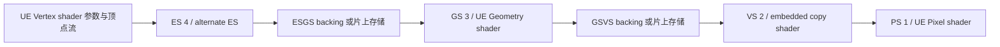

# KH3 GnmRHI：GS/ES、copy shader、ring 与 LS/HS（r6）

本篇接续 [graphics/draw](kh3-gnmrhi-graphics.md)。语义目标仍是 **KH3 CUSA15072 01.10 / `++UE4+Release-4.17`**，并非原版 UE4.18。所有地址为 eboot 模块偏移，不含运行时基址。证据是完整 Hex-Rays 伪码、原始 ELF 对应指令与本仓 GNM 寄存器定义；本轮没有运行游戏、捕获 GS/tess draw 或取得原始 GnmRHI 源码。

这轮已把 **UE VS/GS 绑定 → ES/GS → copy VS → PS → draw** 接入 C++ 参考，补出 ring 分配来源、描述符、片上容量和提交顺序。**LS/HS 的 LCUE 提交可以按给定状态重放，但 KH3 的 UE HS/DS 选择入口还没有闭合**：现有 BSS 工厂、BSS setter、draw 资源准备只消费 VS/PS/GS；同时二进制确实保留了 hull 资源 setter 和 SDK tessellation 分支。不能据前者断言游戏绝无 tessellation，也不能据后者声称已恢复可工作的 UE tessellation 管线。

## 1. 证据身份与函数链

原始 ELF SHA256：`29524c8302995aac8207e69b3e16da81410bce4685d9b010d011c3dec72990b9`；兼容运行时 SHA：`be1ff228eecdb3bcd327a637dd538426c916eb4514cbe4b522f2461fc38e4a8d`。原件位于 `build/validation/odin3-kh3-preempt-20261012/kh3-exe-parent/export/app0/elf/eboot.bin.elf`。分析 ELF 与原件 SHA 不同，不绕过 IDA 导入器的 SHA gate。

本轮完整伪码位于 `build/validation/kh3-gnmrhi-20261016/decomp/stages-*.cpp`；对应原始模块范围的反汇编在 `static/fn_*.asm.txt`。前一轮 `graphics-382bf0.cpp`、`graphics-4c3a220.cpp`、`0x386a40.cpp` 继续使用。Reverse Study generation 为 `dd667cad7bd1fbbb3ccebb78823e22b5857b22066c517c708fbef2960fed29c0`。

| 模块偏移 | 本轮确认的语义 | 证据边界 |
|---|---|---|
| `0x3bace0` | BSS 工厂/缓存，保存 VS/PS/GS | 输入含隐藏返回包装地址；不能套用公开 UE 的六 shader 参数 ABI |
| `0x382bf0` | BSS 选择、ES/GS/copy VS 安装、ring 表和模式 | GS 路由要求 GS 非空且 VS 的 alternate ES 非空 |
| `0x4c3dd50` | off-chip GS 与 copy VS 选择 | 唯一索引到的真实调用点 `0x38323d` |
| `0x4c3e010` | on-chip GS 与 copy VS 选择 | 唯一索引到的真实调用点 `0x383bb3` |
| `0x4c37870` | 片上容量计算 | 两个真实调用点位于 BSS setter 与 `0x38f300` 状态重发路径 |
| `0x4c3ec80` | GSVS ring 的五个 descriptor | 唯一索引到的真实调用点 `0x383511`；尾调下面的寄存器 emitter |
| `0x68bbb10` | GS 四流 itemsize、ring offset、max vertices | 共 17 DWORD，不是分配器 |
| `0x4c3a220` | graphics LCUE | ES/GS → LS/HS → VS/PS，按 mode 位选择前两块 |
| `0x3a5640` | RHI 初始化中的 ring 分配 | 全局 manager 的两个 4 MiB backing |
| `0x3a8260` | 16 KiB 辅助 buffer 重建及 descriptor | 实际只消费 RDI；伪码多出的参数是推导噪声 |
| `0x4c3e390` | GNM/context 初始化、四种 copy reflection | 是初始化器，不是 HS setter；`0x4c3e9f0` 是 DCB 空间 callback |
| `0x369830` / `0x37f900` | hull UB / texture setter | HS5 绑定层存在；不证明 BSS 已选中 HS |
| `0x36a9e0` / `0x36c620` | hull texture / sampler command Execute | RDI 是 command、RSI 是 command list，不是 context/shader |

SQL data-xref 查询对本次几处全局量返回空，但原始 RIP-relative 指令和伪码都有引用。本篇对 ring 来源使用原始扫描和函数内指令，未将索引空结果当作“没有使用”。

## 2. UE shader 与硬件 stage 的对应

| UE 层角色 | 普通 graphics | 带 geometry | tessellation 的 SDK 语义 |
|---|---|---|---|
| `FRHIVertexShader` | VS2 | ES4，使用 alternate ES | 输入 vertex 工作通常由 LS6 执行；KH3 UE 选择桥未证实 |
| `FRHIHullShader` | — | — | HS5 |
| `FRHIDomainShader` | — | — | 无 GS 时 VS2；有 GS 时 ES4 |
| `FRHIGeometryShader` | — | GS3 | 有 GS 时仍为 GS3 |
| GS 随附 copy shader | — | VS2 | 有 GS 时仍为 VS2 |
| `FRHIPixelShader` | PS1 | PS1 | PS1 |

这里的 1…6 是 **GNM 硬件槽号**，不能直接代入 UE 的 `EShaderFrequency`；例如 UE `SF_Geometry=4`，GNM GS=3。LS/HS 行是对 SDK 提交能力与 UE 角色的关联，当前可证明的 KH3 UE 接线是普通 VS/PS 和 GS/ES 两条。



UE renderer 不需要另绑一个“copy shader 对象”。BSS 内部读取 GS native header，安装 copy VS，并把最终 VS→PS semantic linkage 的 VS 端换成 copy shader；拿原始 vertex shader 的输出表做匹配会连错。

`0x382bf0` 读取 BSS `+1b0/+1b8/+1c0` 的 VS/PS/GS。geometry 分支使用 VS 对象 `+260` 的 alternate ES program、`+268` 的 reflection，以及 BSS `+48` fetch shader、`+190` modifier；context `+450` 变为硬件 stage4。VS UB/texture/sampler/SRV setter 仍通过 VS 对象 `+380` 路由。`0x386a40` 为顶点 descriptor 查询当前硬件 stage 的 reflection `+ea`，然后调用 vertex、pixel、geometry 三份 resource-map 展开；GS 版本是 `0x386240`。

参考版保留 **逻辑 UE VS 的 UB 引用、dirty mask 与 loose shadow**，仅把 descriptor 送往 ES4。copy VS 的 staging、program、reflection 单独保留，不能把它误当作用户 vertex 参数的目标。GS 的 20 个 UB 槽、常量立即绑定、资源表延后展开、null texture/SRV no-op 等与前篇一致。

## 3. copy shader 的定位、profile 与 Set/Update

令 `G` 为 GS native header：

```cpp
copyHeader = G + 4 * uint8(G[3]) + 0x38;
copyFlags  = uint8(*(copyHeader + 0x26));
onChip     = (copyFlags & 2) != 0;
compact    = (uint32(*copyHeader) >> 24) == 1;
```

byte[3] 不是 DWORD[3]。这个地址指向 **native header**，不是 shader ISA 首地址。copy header 的 code、register body 和 semantic 表仍需由 shader loader 解码；reference 没有假造 loader。

四个 profile 由 `0x4c3e390` 建在每个 LCUE context 中。以下 offset 均相对 **LCUE = GNM+2e8**：

| profile | 地址 | TableDwords | 有效的特殊 selector |
|---|---|---:|---|
| off-chip compact | `+c268` | 0 | `+c=0`，指向共享 ring table |
| off-chip extended | `+c380` | 64 | `+c=0`；`+6=2`，指向本 stage table 的 offset20=0 |
| on-chip compact | `+c498` | 0 | `+f=0`，传递两个 WORD 因子的乘积 |
| on-chip extended | `+c5b0` | 64 | `+f=0`；`+6=2` |

每块大小 `0x118`，初始化为 `ff` 后覆盖已知字段；extended 的 `+10a/+10c/+10e/+110` 为 `0,4,8,12`，是另一张辅助映射，**不是**顶点 element map `+ea`。目前没有恢复这张辅助映射的所有填充者；参考要求提供相应 staging，不能把 64 DWORD copy table 自动认作四个 GSVS write descriptor。

两个 GS selector 同时安装 GS3 和 copy VS2。两者都按 native program `+18/+1c/+20` 三个 DWORD 比较 Set/Update key，并使用前篇的 emitted-bit 条件；copy VS 的 fetch pointer 和 modifier 归零。ES4 没有该 Update 分支，发 `sceGnmSetEsShader`。

## 4. ring 的 owner、内存表与寄存器

### 4.1 manager backing 与 DCB table 是两层存储

原先识别的 manager 全局位于 `0xa7260e0`。本轮闭合了它的前 `0xb0` 字节：

| manager 内偏移 | 全局地址 | 内容 |
|---|---|---|
| `+0` | `0xa7260e0` | 16 KiB 辅助 backing；descriptor 位于 +20；table index 位于 +30，初值0 |
| `+38` | `0xa726118` | 第二个 16 KiB 辅助 backing；table index 初值1 |
| `+70` | `0xa726150` | ESGS backing，4 MiB，64 KiB 对齐 |
| `+90` | `0xa726170` | GSVS backing，4 MiB，64 KiB 对齐 |

`0x3a5640` 调用分配器 `0x37d4ba0(...,1,0x400000,0x10000)` 两次；`0x3a8260` 为两个辅助对象分配/重建 16 KiB，生成 `[lo, hi12|80003000, 4000, ea7204]`。**辅助 buffer 的完整消费者尚不清楚，不能命名成 tess factor ring。** 它们都是全局 manager 的成员；每次 shader 切换重新分配 4 MiB 并不是这里的行为。完整销毁和并发使用约束未在本轮重新闭合。

off-chip BSS 路径比较 context `+508…+51c` 六个 key：ES native `+1c`、GS native `+24/+28/+2c/+30`、GS `word34&7ff`。变化才预留 DCB 52 DWORD，在 NOP 中放 **48 DWORD / 192 byte** 表。已对齐 DCB 的编码为 `[c0301000,68750000, payload[48]]`，实际前移50 DWORD。表地址存 **GNM+360 = LCUE+78**。未变化时复用旧表；旧 DCB 和 table 必须存活到使用它的 GPU 命令完成。

因此至少要区分：manager 的大 backing、DCB 内共享 ring descriptor table、各 stage 的 LCUE staging/upload snapshot。三者地址与寿命不能混用；切换时的寄存器 reset 也不是“GPU 已不再用旧 backing”的 fence。

### 4.2 192-byte table 的已知部分

| 字节偏移 | 描述符 |
|---|---|
| `+00/+10` | 两个辅助对象的 descriptor，实际位置按各自 table index |
| `+20` | ESGS write：`[baseLo, hi12|80003000, 400000, ea7204]` |
| `+30` | ESGS read：`[baseLo, hi12|3000, 400000, 27204]` |
| `+40/+50/+60/+70` | 四个 GSVS write descriptor |
| `+80` | GSVS read：`[baseLo, hi12|3000, 400000, 27204]` |
| `+90…+bf` | 本函数未写；不推断为全零或另三个描述符 |

令 `V=GS.word34&0x7ff`、`S[i]=GS.word(0x24+4*i)`。第 i 流的地址与字段：

```text
prefixBytes = Σ(j<i) uint32(4*S[j])       // 每项32位乘法，再64位累加
Ai          = GSVSbase + (uint64(V)<<6)*prefixBytes
word0       = low32(Ai)
word1       = hi12(Ai) | 0x80003000 | (((V<<18)*S[i]) & 0x3ffc0000)
word2       = 64
word3       = 0x00aa7204
```

高地址必须随各流偏移重新计算；只改低32位会在跨4 GiB边界时出错。测试覆盖这一点。

`0x68bbb10` 发出的 context register（DWORD index）如下，名称由本仓 `regs.h`、`regs_vertex.h` 和 GNM emitter 交叉对应：

| register | 写入 |
|---|---|
| `2d7…2da` / VGT_GS_VERT_ITEMSIZE0…3 | `S[i]&7fff` |
| `298…29a` / VGT_GSVS_RING_OFFSET1…3 | `V*S0`、`V*(S0+S1)`、`V*(S0+S1+S2)`，各取低15位 |
| `2ce` / VGT_GS_MAX_VERT_OUT | `V` |
| `2ac` / VGT_GSVS_RING_ITEMSIZE | `V*ΣS` 取低15位 |
| `2ab` / VGT_ESGS_RING_ITEMSIZE | BSS setter 另写 `ES.word1c&7fff` |

### 4.3 on-chip 的容量与模式

`0x4c37870` 的 DWORD 运算：

```text
instances = ((word34>>11)&31)+1
extra     = (word34>>16)&255
bytes     = 4*(instances*extra + V*ΣS)
bytes>65536: groups=lds512=0
否则 groups=min(65536/bytes, instances==32 ? 63 : 64)
lds512=(bytes*groups+511)>>9
```

`extra` 的完整 shader metadata 名称尚未确认，代码保留 raw word。原函数 bytes=0 会除零；reference 对错误输入返回零预算并在 UE adapter 拒绝，是明确的防误用差异。

on-chip 把 `lds512` 放 LCUE `+c6e4`。ES shader dirty 时，非零值用于临时修改 native `+14`（SPI_SHADER_PGM_RSRC2_ES）的 bits20…28；**零值直接使用原始 register body，不能清掉原 header 中的 LDS 位**。仍使用 reserve20 的 `sceGnmSetEsShader`，并保持原 header 不变。

off-chip 的 VGT_GS_MODE=`180003 | cut<<4`；cut 由 `4*V*ΣS` 与 `204/404/804` 比较得到3/2/1/0。on-chip 的 cut 来自 `copyFlags[5:4]`，mode=`600003 | cut<<4`。令 `N=groups*instances`，VGT_GS_ONCHIP_CNTL=`(N&7ff)|((groups<<11)&3ff800)`。按本仓字段定义，低11位为 ES vertices/subgroup、后11位为 GS primitives/subgroup；不把中间变量 N 随意命名为 wave 数。

on-chip key=`(cut<<22)|groups|((N<<11)&7fff800)`；变化且旧 key 非 -1 时先写 GS_MODE=0、STRMOUT_CONFIG=0。离开 GS 时同样清模式/streamout，再写 stage-enable=0；进入 GS 时 stage-enable=`b0`。这些是状态重录，尚无内存完成含义。

若 GS reflection `+f` 有效，LCUE `+c6e8` 保存 `uint16(N)`、`+c6ea` 保存 `uint16(ES.word1c)`；GS 和 copy VS 的 selector `+f` 都发二者32位乘积。on-chip 路径不重建上述 off-chip ring table。

## 5. LS/HS 的内部 tessellation 常量与资源绑定

LCUE stage-mode `&1` 进入 LS/HS 块。LS program 在 `+c0d0`、reflection `+c1b0`；HS 在 `+c0c8/+c1a8`。LS/HS 资源 staging 仍为 `LCUE+90+1800*stage`。HS5 texture/UB/sampler 的 direct-SGPR 起点是 `0x10c`；这与已恢复的 hull setter 一致。

### 5.1 9 DWORD 的内部 buffer

`+c712` 非零时启用；初始化器设为1。LS 或 HS shader dirty 则新分配36字节、4字节对齐；否则重用 LCUE `+c6f8` 的旧 descriptor。令 `L=LS.word1c`、`A/B/C/D=HS.word24/28/2c/30`、`P=LCUE.wordc6f4`、`T=HS.word3c`：

| DWORD | 值 |
|---:|---|
| 0 | `L` |
| 1 | `B!=0 && D!=0 ? D : L` |
| 2 | `P` |
| 3 | `B!=0 && D!=0 ? A*L*P : 0` |
| 4 | `16*C` |
| 5 | `P*(L*A+B*D)` |
| 6 | `B*word1` |
| 7 | `44000000`，即 float512 |
| 8 | `T` |

buffer descriptor 原样为 `[lo(addr), hi12(addr)|100000, 3, 20077fac]`。**分配写入9 DWORD，但 num_records 为3**；reference 保留这两个事实，不擅自扩成48字节写入或把 records 改成9/36。

常量通过 reflection **WORD `+e8`** 绑定，先 HS5，后 `2+((mode&20)>>4)`：无GS为VS2、有GS为ES4。这是 domain shader 的消费槽，并非 LS6，也不是 UE UB slot0（后者是 reflection+c2 映射）。`ffff` 跳过写、`8000` 直写 user SGPR、其他写 stage staging；即使 unused，资源 dirty 仍设置。

当程序未变而仅 P 等 metadata 变化时，此块不会自行重分配；缺失的 selection/config setter 需要负责相应 dirty。reference 不掩盖这个调用约束。

### 5.2 LS、HS 的 SDK 参数

LS dirty：`SetLsShader(program+8, modifier)`，reserve23 DWORD，无已恢复的 UpdateLs 分支。HS dirty：复制 native `+8…+20` 七个 DWORD，生成

```text
VGT_LS_HS_CONFIG = uint8(P) | ((HS.word24&63)<<8) | ((HS.word34&63)<<14)
```

由本仓 `LsHsConfig` 可对应 num_patches、input control points、output control points。因此 HS.word24 与 word34 这两个 mask 后字段的用途已有硬件对应，其余内部 buffer 字段仍保留原始偏移名称。

若 LCUE signed `+c708<0`，把临时 native **word18 / VGT_TF_PARAM** 改为 `(old&fff9ffff)|((override&3)<<17)`；这是 TF_PARAM 的 distribution-mode 位，**不是 HS 的 shader resource2**。寄存器位名由本地 OpenGNM `amdgfxregs.h` 的 gfx8 定义交叉核对，是否应用于某一实际 KH3 场景未验证。随后 Set/UpdateHsShader reserve30 DWORD；body 的+1c/+20还带 max/min tess level。

本篇没有证明 `VGT_TF_MEMORY_BASE` 的 backing 分配、完整 tess factor ring 生命周期或 patch-topology draw 接线；两个16 KiB辅助 buffer也不能替代这个证据。现有 direct draw reference 仍仅接受 triangle-list/strip、line-list。

## 6. graphics LCUE 的阶段差异与顺序

| 硬件 stage | common `+7…+e` | fetch / subtables `+4/+5/+6` | scalar `+f` |
|---|---|---|---|
| PS1 | 是 | 否 | 否 |
| VS2（普通或copy） | 是 | 是，按selector是否ff | 两个WORD因子的乘积 |
| GS3 | 是 | 否 | 同上 |
| ES4 | 是 | 是 | 否 |
| HS5 | 是 | 否 | 否 |
| LS6 | 是 | 是 | 否 |

common 中 `+c` 是 LCUE+78 的共享指针；`+d/+e` 是阶段 scalar；表指针仍由独立 LCUE upload 快照取得。不能把“每阶段都有同一个 reflection struct”理解成“所有 selector 都会发”。

```text
mode & 20:
  ES program → GS program → ES table → GS table → 清这组 dirty
mode & 1:
  [生成或重用9-DWORD常量 → 绑定HS与domain]
  LS program → HS program → LS table → HS table → 清这组 dirty
总会到达正常尾部:
  VS program → PS program → VS table → PS table → VS/PS semantic link
  → draw emitter（调用者）
```

**组合 GS+tess 路径存在必须保留的静态顺序问题**：ES/GS 块已经结束，tess 常量才可能把 ES 的资源再次标脏；本次尾部只处理 VS/PS，不回头重提 ES。direct mapping 会当场写ES SGPR，table mapping 则留下 ES dirty。参考重放保留这一行为并测试；未在真实 KH3 draw 上验证，不“修正”为另一个更合理的顺序，也不据此判断一个实际游戏 bug。

## 7. C++ 实现与验证

| 文件 | 本轮内容 |
|---|---|
| [GnmStagesCore.h](../../tools/gnmrhi-semantics/ue4-reference/GnmStagesCore.h) | copy地址/profile、预算/cut/模式、ring descriptor/register、ES LDS patch、9-DWORD tess常量、HS config/TF_PARAM、`CommitLsHs` |
| [GnmGraphicsCore.h](../../tools/gnmrhi-semantics/ue4-reference/GnmGraphicsCore.h) | 六种 graphics stage 的 selector差异；ES/LS不设置Update所需的issued位 |
| [GnmGraphics.cpp](../../tools/gnmrhi-semantics/ue4-reference/GnmGraphics.cpp) | 真实 UE GS overload、逻辑VS→ES资源路由、ring快照、ES/GS→copyVS/PS提交 |
| [GnmGraphicsTypes.h](../../tools/gnmrhi-semantics/ue4-reference/GnmGraphicsTypes.h) | `FRHIGeometryShader`派生对象、alternate ES、embedded copy shader、ring cache |
| [UECallSite.cpp](../../tools/gnmrhi-semantics/ue4-reference/UECallSite.cpp) | `FRHICommandList`的VS/GS资源绑定与draw调用示例 |
| [stages_tests.cpp](../../tools/gnmrhi-semantics/cpp/stages_tests.cpp) | 直接编译共享C++14核心的8组测试 |

shader loader 需提供原生 header/semantics/key、alternate ES、copy shader 与 reflection，且在发布 GS 对象前调用 `FinishDecodedMetadata()`；这不是序列化 blob 的完整反编译。adapter 继续提供 SDK emitter、真实分配与生命周期。新增 `GetGeometryRings()` 返回 manager 级 backing；`EmbedGeometryRingTable()` 必须在 DCB NOP 内预留真实存储，不得用普通heap地址代替。其未写尾部必须保留。初始 staging/loose、非compact copy辅助数据仍由真实初始化/捕获状态提供。

LS/HS 使用 `CommitLsHs` 处理已给定的 `StageView`、metadata 与 cached descriptor；Sink 的 SetLs/SetHs 接真实 SDK。reference 的 UE BSS 对 `bHasTessellation` 明确拒绝，避免把尚无证据的 UE shader选择/patch draw 写成假实现。完整函数签名、modifier、反射和dirty字段保存在符号类型里，后续可继续补接。

验证：MSVC19.51 Debug 构建、CTest **3/3**，共原13个场景、6组graphics、8组stages；覆盖copy四profile、64/63组上限、超预算、GS模式切换、ring跨4GiB、四流寄存器、六阶段selector、tess分支/descriptor缓存/绑定顺序/combined-mode残留dirty。不是实机二进制差分。UE公共头文件签名比较 **29个override通过**；完整UE/PS4 SDK工程与设备画面没有验证。

[符号 index](../../guest/games/CUSA15072/01.10/symbols/index.json) 为 **r6 / 6 shards / 100 symbols / 75 typed / 39 types**。新增[stages shard](../../guest/games/CUSA15072/01.10/symbols/gnmrhi-stages.symbols.json)含16个条目、9个部分类型；manager+0复用既有manager符号，不制造重复地址。prepare dry-run及实生成成功；clang `x86_64-none-elf` 的 **365个size/offset断言**与生成C语法检查通过。生成件在 `build/validation/kh3-gnmrhi-20261016/symbols-generated-r6/`。

## 8. 分析其他 UE PS4 游戏时如何复用

优先定位 draw前的graphics commit，再查 mode&20 / mode&1、stage program/reflection数组、每stage `0x1800` staging、copy header计算与两种ring mode；以新游戏的ELF身份重新校验，不复用KH3绝对offset。随后沿 vertex setter 的 hardware-stage字段确认顶点参数是否进ES/LS，沿reflection+e8确认内部tess常量的消费者，最后定位 BSS 工厂是否真的收HS/DS，以及TF ring和patch topology从哪配置。

本轮最明确的未闭合点是：KH3 HS/DS 创建与选择、LS编译变体/fetch建立、tess factor backing、非compact copy辅助表填充、完整streamout绑定、shader blob loader、GPU命令完成后的ring销毁/并发约束。现有结果可帮助识别这些函数，不用于解释尚无证据关联的KH3闪黑。
