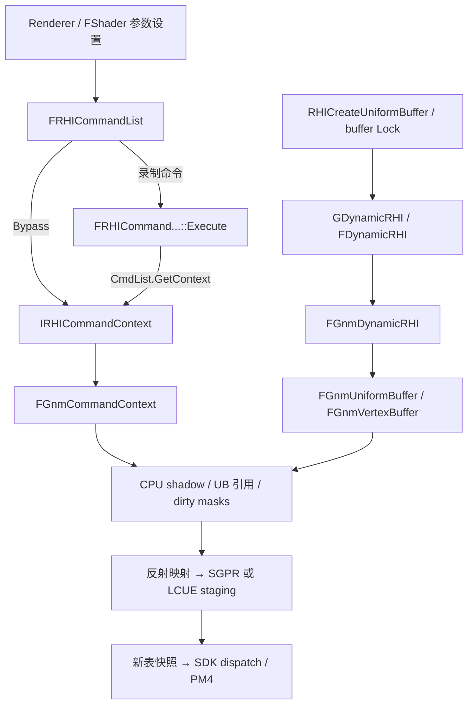

# KH3 GnmRHI 与 UE RHI 的直接关联及 UE 风格参考实现

2026-10-16。用户要求把已有语义模型接回 UE 的实际实现层次，本篇补齐 **Renderer → command list → RHI context / dynamic RHI → Gnm 对象 → LCUE / SDK** 的关系，附 [UE 风格 C++ 参考代码](../../tools/gnmrhi-semantics/ue4-reference/README.md)。本文所指 GnmRHI 与本次对话中的 GCMRHI/RNMRHI 是同一个分析目标，没有另行假设一个同名模块。

## 1. 版本与证据

后续进展见 [graphics/draw 深入还原](kh3-gnmrhi-graphics.md)：普通 VS/PS、vertex fetch、graphics LCUE 与 linker 已加入 UE 参考；当前接口检查24项，符号revision5。本文末尾的r4数字保留为该轮历史验证记录。

**语义目标仍是 KH3 01.10 的 UE4.17 分支。** 原始 ELF SHA256 为 `29524c8302995aac8207e69b3e16da81410bce4685d9b010d011c3dec72990b9`，含 `++UE4+Release-4.17`。不能仅靠这个字符串断言游戏等同于 stock 4.17.0 或 4.17.2；更不能按通用 4.18 的行为覆盖游戏实测。

**接口参照是本地保存的 4.18 通用源码。** 来源 `windystrife/UnrealEngine_NVIDIAGameWorks`，固定 revision `b50e6338a7c5b26374d66306ebc7807541ff815e`，本地根目录：

```text
build/validation/kh3-gnmrhi-20261016/ue418/files/Engine/Source/Runtime/
```

下文的 UE 文件行号均相对这个根目录。本轮没有新下载资料、使用主机平台私有源码或操作设备。新增静态证据位于 `build/validation/kh3-gnmrhi-20261016/static/fn_{36cb00,36a4c0,377bc0,369390}.asm.txt`；四个函数边界来自 ELF unwind 表，解释依据指令，不冒称已获得原始 C++ 名称。

参考版使用真实 UE 头文件 / `FRHI*` 基类 / `TArray` / `TRefCountPtr`，用 UE 的接口承接已恢复的 KH3 行为。**不是完整的 UE 平台模块，也未在完整 UE4.17 或 PS4 SDK 工程中编译。** 当前是可供人工关联和后续接入的实现片段；完整可编译的独立模型仍是此前的 [C++20 版本](../../tools/gnmrhi-semantics/cpp/README.md)。

## 2. UE 里的入口到底落在哪个类



`FDynamicRHI` 负责资源创建、Lock、CPU 查询等接口；shader 参数、资源绑定、draw / dispatch 是 `IRHICommandContext` 的职责。两者不能全部揉进一个与 UE 无关的 `GnmRhi` 门面类，再称作 UE 对应实现。

| UE 原始接口 / 调用点 | KH3 证据（模块偏移） | 参考版位置 |
|---|---|---|
| `RHICommandList.h:2073` `SetShaderParameter`，`RHICommandListCommandExecutes.inl:115` Execute 分派；`RHIContext.h:116/476` CS 重载 | `0x377bc0` CS wrapper → `0x368f70`；`0x369390` 为 inlined Execute 候选 | `FGnmCommandContext::RHISetShaderParameter` |
| `RHICommandList.h:2057` `SetShaderUniformBuffer`；`RHIContext.h:114/464` | `0x36a4c0` 保存 UB / 绑定常量 / dirty | `FGnmCommandContext::RHISetShaderUniformBuffer` |
| `RHICommandList.h:3102` `SetComputeShader`；`RHIContext.h:54` | `0x36cb00` 程序、反射和 dirty 设置 | `FGnmCommandContext::RHISetComputeShader` |
| `RHICommandList.h:3137` `DispatchComputeShader`；`RHIContext.h:65` | `0x36cfb0` → `0x36db40` / `0x4c39b50` → SDK | `FGnmCommandContext::RHIDispatchComputeShader` |
| `RHICommandList.h:3147` `DispatchIndirectComputeShader`；`RHIContext.h:67` | `0x3772d0`，执行时取 multibuffer 当前 backing | `FGnmCommandContext::RHIDispatchIndirectComputeShader` |
| `DynamicRHI.h:221` `RHICreateUniformBuffer` | `0x391d20` 包装、`0x3a3ce0` 构造 | `FGnmDynamicRHI::RHICreateUniformBuffer` |
| `DynamicRHI.h:239/242` `RHILock/UnlockVertexBuffer` | `0x39a100` Lock、`0x3cbeb0` Unlock；`0x3a3010` 槽数策略 | `FGnmDynamicRHI` 与 `FGnmVertexBuffer::Lock` |
| `DynamicRHI.h:803` `RHIGetDefaultContext` | 属于 UE 接入关系，KH3 的具体工厂入口本轮未恢复 | 返回参考 context，仍要求外部完整实现 |
| `RHIContext.h:260` `RHISubmitCommandsHint`、`:266` `RHIEndDrawingViewport` | pending batch / 最终提交见 `0x372930/0x372b20/0x39c920`；不把这些 helper 直接认成虚方法入口 | 见[提交还原](kh3-gnmrhi-reconstruction.md)，本参考片段未实现 |
| `DynamicRHI.h:672` `RHIGetRenderQueryResult` | `0x3a0d10` 属于等待路径，query Begin/End、ready 条件已另记 | 见[query 还原](kh3-gnmrhi-reconstruction.md)，不新增假的等待实现 |

`IRHIComputeContext` 还由 `IRHICommandContext` 继承（`RHIContext.h:153`）。普通图形 command list 的 compute 命令走 `GetContext()`；async compute 的执行器通过 `ECmdList::ECompute` 选择 `GetComputeContext()`（`RHICommandListCommandExecutes.inl:9–18`）。这解释了同一个 CS 参数接口可在两类 command list 中出现，不证明 KH3 两者共享同一队列或同一实例。

公开 Renderer 的具体例子是 `Renderer/Private/CompositionLighting/PostProcessAmbientOcclusion.cpp:656` 的 `SetComputeShader` 和 `:668` 的 dispatch。这里只用来说明 UE 调用方式，不据此认定 KH3 使用相同 AO pass、shader 或排列。

## 3. loose 常量的三次复制要分开

以公开 UE command list 的非 Bypass 模式为例：

1. Renderer 传入参数字节。`SetShaderParameter` 用 `Alloc(NumBytes, 16)` / `Memcpy` 保存 command payload，使调用者的栈变量之后可以失效。
2. RHI 命令执行时，Gnm 把 payload 复制到 CS 的 CPU shadow（context `+0xae8`），更新 high-water / dirty。这一步还没有新建 GPU 常量 backing。
3. dispatch 准备阶段，shader 使用 loose constants 且 shadow dirty 时，`0x36d740` 将 shadow 前缀复制到新上传区，生成 descriptor；绑定后调用者清 dirty / updated-end。

Bypass 时跳过第 1 个 command payload，后两步仍存在。**UE command 内存、Gnm shadow、GPU 可读常量内存是不同层次。** LCUE staging 到上传表的复制又是描述符数据的另一条路径，不是上述常量字节复制。

新增 ABI 对照 `0x377bc0`：

| 寄存器 | UE 含义 | 实际处理 |
|---|---|---|
| RDI | context / this | 取 `+0xae8` shadow |
| RSI | ComputeShader | 本 wrapper 未使用 |
| EDX | BufferIndex | 本 wrapper 未使用 |
| ECX | BaseIndex | `movzx edx,cx`，只取 low16 |
| R8D | NumBytes | `movzx ecx,r8w`，只取 low16 |
| R9 | NewValue | 移到 RSI，尾调 `0x368f70` |

`0x369390` 从 `CmdList+0x20` 取 context，从 command `+0x18/+0x24/+0x28` 取 source / BaseIndex low16 / NumBytes low16，同样尾调 helper，符合 Execute 内联后的形状。仍标候选：没有恢复模板名、ECmdList 实参或完整 command 结构。**不能由 WORD 读取反推 command 的原字段就是 uint16**，公共 UE 接口与 command 字段是 uint32。

参考代码保留截断行为，以便与二进制对照；这不是建议调用者向 UE 传超过 16 位范围的参数。

## 4. UB 有常量描述符和资源表两条绑定路径

UE `FRHIUniformBufferLayout` 的 `ConstantBufferSize` / `ResourceOffset` / `Resources` 对应 KH3 已恢复的 layout `+0/+4/+8`，资源数在 `+0x10`。资源指针的起点由 **ResourceOffset** 决定，不能简单把它写成 `Contents + ConstantBufferSize`。

创建时 `0x391d20/0x3a3ce0`：复制常量到 backing、构建四 dword descriptor、复制资源指针并 AddRef。参考版用真实 `FRHIUniformBuffer` 派生对象和 `TRefCountPtr<FRHIResource>` 表达这层所有权。

新增 setter `0x36a4c0` 的次序：

```cpp
// 语义概要；完整 UE 方法在 GnmCommands.cpp。
ConstantSource = Buffer && Buffer->constantSize != 0 ? Buffer : GlobalDefaultUniform;
if (ConstantSource->constantSize != 0)
    BindDescriptor(CurrentCSReflection.constantSlots[BufferIndex], ConstantSource->descriptor);
BoundComputeUniforms[BufferIndex] = Buffer; // 原始对象，包含引用计数交接
ComputeUniformDirty |= 1u << BufferIndex;
```

默认 UB 指针来自模块 `0xa726658`，其创建和内容尚未恢复，因此代码要求外部提供，**没有用全零 descriptor 代替**。即使常量使用默认 UB，资源槽保存的仍是原 UB：resources-only UB 的纹理/SRV/sampler 没有被默认对象替换。

到 dispatch 的 `0x36db40` 才计算 `Shader.ResourceTableBits & ComputeUniformDirty`，逐个 UB 按 texture / SRV / sampler map 展开。packed entry 直接对应 UE `FRHIResourceTableEntry`：高8位 UB index、中16位 resource index、低8位 bind index。map 前缀给每个 UB 的起点；0 表示无项，遇到其它 UB index / 终止项结束，最后清整个 CS dirty mask。

因此 `SetShaderUniformBuffer` **既有立即写绑定，又有延迟展开**，不能只把它描述为“更新一个指针，所有绑定都等 dispatch”。直接 SGPR 与 table mapping 仍遵守 `ffff` 未使用、bit15 选择、低14位索引的已恢复规则。

## 5. shader 切换不等于把所有状态标脏

`0x36cb00` 补上了之前缺失的 shader setter：

- context `+0x920` 持有新 shader，按 UE 资源引用方式交接旧引用。
- 将 context `+0x428` 数组的 `+0x430` 个 pointer-sized 项清零；数组用途仍未确定，不把它命名成确定的 UAV 或纹理表。
- shader `+0x1d8` 是 program 指针，`+0xb0` 是 **内嵌 reflection**，不是另一根 reflection 指针。
- GNM `+0xc530` 累积 `oldProgram != newProgram`；`+0xc538` resources dirty 置1；`+0xc54e` OR1。
- GNM `+0xc9c1 = program[0x24] & 3`，影响 dispatch flags；program 的 WORD `+6` 非零时写 `SET_SH_REG` 寄存器 `0x218`，字值是 `(((word6 << 10) + 0xc00) & 0x1fff000) | 0x240`。
- reflection `+0xd != 0xff` 时写 GNM `+0xc3c8 = 0x40`。该 special-binding 路径没有完成全部恢复，参考版 dispatch 拒绝带有未恢复 extras 的输入。

**该函数体没有写 context `+0x91c` 的 UB mask，也没有写 loose shadow dirty。** 参考版不加“切 shader 自动令全部 UB dirty”的猜测。其它 context reset、shader 参数重设、pipeline 包装是否产生额外 dirty，仍需各自追踪，不能把本函数结论扩大到整个引擎。

这也解释了四种状态必须分开：UE UB dirty mask、loose bytes dirty、LCUE descriptor-table dirty、SDK shader-program dirty。它们的消费者和清零时点不同。

## 6. 资源寿命与 UE 的边界

`FRHIResource` 的 CPU refcount 负责 UE 对象寿命，不能单凭 Release 就释放 GPU 仍在读的 backing。参考 UB 析构调用适配器的 `RetireUniform`：持久 backing 走已恢复的 ticket 完成条件；临时 backing 由块池持有。平台分配器必须保持 CPU/GPU 内存映射和提交引用有效。

`FRHIUniformBuffer` 原基类只保存 layout 地址。为避免参考调用者把局部 layout 传入后悬空，参考派生对象先在独立基类存储中复制 layout，再把该地址交给 RHI 基类。**这是示例的所有权整理，不是 KH3 的原始对象布局**；符号包中仍保留真实 `+0x18` 外部 layout 指针。

Lock 也要区分两层：公开 UE `LockVertexBuffer_RenderThread` 在有 RHI 线程时可能先给暂存，排队后再执行平台 Lock；本参考实现的是后者。KH3 ordinary Dynamic 每次写 Lock 轮换三槽、Volatile 新分配、Dynamic|UAV 单槽，既不等同于 UE command payload 复制，也不是“每帧轮一次”。

UE `EShaderFrequency` 为 Vertex0 / Hull1 / Domain2 / Pixel3 / Geometry4 / Compute5；已恢复 GNM stage 为 CS0 / PS1 / VS2 / GS3 / ES4 / HS5 / LS6。参考 emitter 固定写 CS user SGPR base `0x2e40`，绝不把 `SF_Compute` 直接代入七项 GNM 表。其它游戏的 vertex 阶段还可能路由到 ES / LS，需按实际配置分析。

## 7. 符号与验证

沿用 `spatial-guest-reconstructed-symbols` 工作流，新增 [gnmrhi-ue-bridge.symbols.json](../../guest/games/CUSA15072/01.10/symbols/gnmrhi-ue-bridge.symbols.json)：四个函数、一个默认 UB 指针数据符号、六个部分结构。新名字、原型、字段保持 `candidate`；命名方便不是独立验证。

[index.json](../../guest/games/CUSA15072/01.10/symbols/index.json) 升为 **revision 4：66 个符号、21 个类型、45 个带原型符号**。保留原始 ELF SHA 和兼容 runtime SHA，未修改 IDA 输入 SHA 门禁。新生成产物目录为 `build/validation/kh3-gnmrhi-20261016/symbols-generated-r4/`。

`guest_debug_symbols_prepare` 的 dry-run / 实生成均通过，校验四个分片哈希、原始 ELF 和兼容运行时身份。clang `x86_64-none-elf` 通过 **173 个 C size/offset 断言**及生成 C 的语法检查；这验证部分布局的内部一致性，不会把 candidate 自动提升为 proved。

参考代码的 10 个 override 已用[接口检查器](../../tools/gnmrhi-semantics/ue4-reference/check_ue_interfaces.py)对照上述原始公共头文件，报告位于 `build/validation/kh3-gnmrhi-20261016/ue-reference-interface-check.json`，记录源头文件哈希。这是接口一致性验证，不是 UE4.17 编译或 GPU 正确性证明。未恢复的虚方法、平台分配、完整 texture/UAV 路径、graphics commit、提交和队列调度均显式保留边界。

下一步分析其它 UE PS4 游戏时，应复用这里的 **UE 入口形状、参数顺序、引用交接、packed entry 格式、四类 dirty 的职责** 来找对应函数，再重新确认版本、字段偏移和指令。KH3 的地址、数组容量与全局默认对象不能直接迁移。
