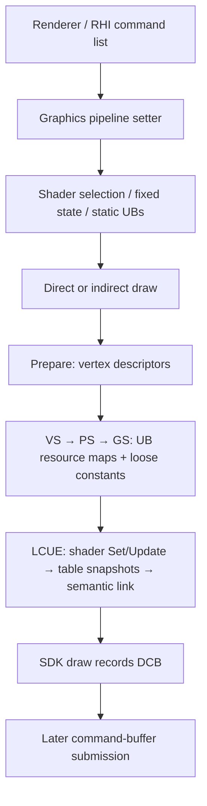

# Tetris Release-4.26：graphics、资源绑定和 LCUE 与 KH3 的对照

2026-10-16。本轮将 CUSA13427 的 **pipeline setter → vertex/UB/loose constants → 普通 VS/PS LCUE → direct/indirect draw** 接回 UE 职责，并提供可独立编译的 [C++14 参考](../../tools/gnmrhi-semantics/ue426-reference/README.md)。这不是把 KH3 的字段整体平移：stream、pipeline、反射和资源表顺序均有实际差异。

曝光闪烁原因和实机验证分别见 [读回分析](tetris-ue426-gnmrhi-readback.md)、[验证记录](../validation/android-native-host/tetris-exposure-readback-20261016.md)。本文新增的是静态还原和 CPU 语义测试；没有把参考实现替换进游戏，也没有做新一轮 GPU 回归。

## 1. 身份、方法与边界

- 游戏：Tetris Effect: Connected，CUSA13427，SFO的VERSION=02.05、APP_VER=01.00；原 ELF SHA256 `157845ba4297a000ac9cfeb26b7b78925d7d903a2ee34575c74d0f5ede6e9677`，分支字符串 `++UE4+Release-4.26-CL-0`。
- 本文函数地址为 **eboot 模块偏移**。对象字段、寄存器和偏移一律十六进制；计数/大小明确标单位。主 RX 文件偏移=模块偏移+`4000`；不能套用到 RELRO。
- `.eh_frame_hdr` 提供函数起点，原始 x86-64 指令核对参数和布局，resolved SCE relocations 核对虚表。完整 ELF/反汇编留在 `build/validation/tetris-gnmrhi-20261016/`。
- Reverse Study 打开此 ELF 再次返回 `database_in_use`；没有中断已有 IDA。本轮 **没有 Tetris Hex-Rays 伪码**，C++ 为人工语义重写。候选函数名不是 PDB/DWARF 原名。
- [evidence.json](../../tools/gnmrhi-semantics/ue426-reference/evidence.json) 固定 39 个函数的模块偏移、文件范围及 SHA256；范围到下一 FDE，可能包含对齐字节。`verify_evidence.py` 已验证所有范围。它不是 v2 符号包，不向 IDA 导入。
- 没有可用的本版完整 UE4.26/PS4 SDK 头文件，因此参考对象是 **normalized C++ 对象**，没有伪造 `FRHI*` 基类或把 4.18 头文件当 4.26 ABI。UE 接口名表示已证实的职责，不能据此直接生成 ABI hook。

## 2. UE 入口与三层 this

记完整 context 为 **C**，内嵌 GNM/DCB context 为 **G=C+348**，LCUE 为 **L=C+510=G+1c8**。另一个 context interface 子对象位于 **C+218**。



| UE 职责 | 本版 native 入口 | 关联证据 |
|---|---|---|
| `RHISetGraphicsPipelineState` 候选 | `f9af50`，primary vtable `5fcdb60` +78 | C/current pipeline+ba58；新旧 pipeline 分别进入 full/differential 路径；第三参数低字节控制 static UB 绑定 |
| `RHISetStreamSource` | `f99210`，primary +130 | C、stream index、VB、Offset；无 Stride 参数 |
| texture / sampler / SRV | `f96b70` / `f96f70` / `f96d90` | shader+28 的 UE frequency 分派，再选 LCUE hardware stage |
| UB / loose parameter | `f97c30` / `f97130` | descriptor 当场绑定；UB 引用/dirty 与 shadow 留给 draw 准备 |
| `RHIDrawPrimitive` | `f96140`，primary +158 | C、BaseVertex、NumPrimitives、NumInstances；topology 取 pipeline |
| `RHIDrawIndexedPrimitive` | `f96460`，primary +170 | C、IB、BaseVertex、FirstInstance、NumVertices、StartIndex，之后两个栈参数 |
| primitive indirect | `f96310`，primary +160 | 参数 buffer+byte offset |
| indexed indirect | `f96690`，primary +168 | 参数 buffer+argument index，内部乘20 |
| indexed primitive indirect | `f96840`，primary +178 | 参数 buffer+byte offset |
| PrepareGraphics | `f95620` | C、FirstInstance；不是 public draw 或 LCUE |
| graphics LCUE commit | `3c4de20` | RDI=L，仅录制命令，不是 queue submit |

secondary vtable `5fcdd58` 的 +208/+210/+218/+220/+228 指向 `f962f0/f96440/f96820/f96670/f969d0`，这些 draw thunk **this-=218** 后进入上表。不能在已经是 C 的指针上重复减。`f9b1a0` 是空函数，不能凭相邻地址把它标成 pipeline thunk；也不能把 command Execute 的 command-list this 当 context。

### 已消费的 context 字段

| C 偏移 | 内容 |
|---|---|
| +ba58 / +ba60 | 当前 graphics pipeline / compute shader |
| +bab4/+bab8/+babc/+bac0 | cached index type / base vertex / instance count / first instance |
| +bad0 | 16个 stream，每项16字节：地址+0，remaining bytes+8 |
| +bbd0 | vertex descriptor dirty |
| +bbd8 | UE VS UB引用起点；每频率20个指针，stride=a0 |
| +bf98 +4×frequency | 五个 UB resource dirty mask |
| +bfb0 / +bfb8 | discard loose extent / static UB 全局槽数组 |
| +bfc8/+bfd0/+bfd8 | VS/PS/GS loose shadow 指针；CS在+bfe0 |

UE frequency 在这些 switch 中为 VS0/HS1/DS2/PS3/GS4；GNM stage 为 CS0/PS1/VS2/GS3/ES4/HS5/LS6。这两套编号不能互换。逻辑 VS 的 hardware stage 来自 shader+394；GS 模式时可以是 ES4。

## 3. Pipeline：预编译状态、shader 选择与 static UB

`f9af50` 以旧 pipeline 是否存在选择 `f9f470(new,G,0)` 或 `f9f840(new,G,old)`，随后保留新引用、设置 vertex dirty/discard extent、把五个 UB mask 全部写成 `fffff`。它 **没有**强制设置 loose shadow dirty，也没有立即 draw 或 submit。

| pipeline 字段 | 本版已读用途 |
|---|---|
| +18/+20/+28 | VS/PS/GS shader 对象 |
| +30…+4c | 8个 blend control words |
| +50/+54/+58，+5c/+60/+64 | raster、bias、depth/stencil 等预编译状态；完整公开成员名未逐一确认 |
| +68 | UE topology enum，draw 取它算元素数 |
| +80 | fetch shader |
| +a0/+a8 | 12-byte vertex element 数组指针/数量 |
| +b0/+b4/+b8 | VS modifier / ES LDS override候选 / GS budget参数 |
| +bc / +c0…+d4 | 是否需要 ring 表 / 六个 ring layout words |
| +d8/+dc | vertex hardware stage / stage-enable mode |
| +e4…+f0 / +f4 | blend constant / loose mask（VS1、PS2、GS4） |

这是持有 shader、编译后 declaration、GNM fixed-state words 的 native pipeline 容器；不能把它简化成 KH3 的 BSS，也不能描述成一个宿主 Vulkan pipeline handle。

普通 full 路径：处理模式切换/旧 GS 状态 → SDK stage-enable → select VS → select PS（允许空）→ ring 表分支 → fixed states。differential 路径比较 VS/GS **对象指针**决定是否重选 VS/ES/GS，比较 PS 对象指针决定是否重选 PS。如果 shader 对象不变，fetch/modifier 不会单独触发重选；这依赖上游 pipeline 构造的不变量，本轮没有据此断言原游戏有 bug。blend constant 和 +64 仍有无条件写入，不能将全部 fixed state 改成“仅 pipeline 指针不同时写”。

第三参数为真时按 **VS→GS→PS** 展开 static UB：shader+260 指向 byte 槽表，+268 为数量，255跳过；从 C+bfb8 的全局数组取 UB，并向 `184f170(UB,globalSlot,shader+240[slot])` 交付校验信息，非空才调用 UB setter。最后一个表值的语义是 layout hash 候选；`184f170` 内部检查本轮未恢复，C++ 保留必须实现的 validation 边界。

### Shader Set / Update 状态机

VS/PS 普通 program 在 shader+1e0，reflection 内嵌于 shader+b8；KH3 对应+1d8/+b0。`3c4f510` 为 VS selection，`3c4f5d0` 为 PS selection。

- shader dirty 累积 `oldProgram != nextProgram`；VS resources 总标脏，PS 取 next!=null。
- 选择 SDK Update 需 old/next非空、shader dirty、此 stage 已 emitted，且 native program 的 key 相同。
- VS 比较 DWORD +18/+1c/+20；PS 比较8个 DWORD +18…+34。
- selection 清 emitted；commit 真正录入 shader 后才重设。连续 selection 两次但没 commit 会失去 Update 资格。
- selection 清 cached PS input linkage；同 pipeline shader 对象没有变化时，differential apply 可以完全不进入 selection。

参考 `CommandContext::RHISetGraphicsPipelineState` 实现普通模式的选择/dirty/static UB；mode cleanup、固定状态发包和资源引用保留通过必需后端接口接入，没有填成成功占位。

## 4. Stream、prepared declaration 与 vertex fetch

`f99210` 只快照 `VB+60 currentAddress + Offset` 和 `VB+14 size - Offset`，VB为空则两者为0。换 backing 后若没有重新执行 setter，stream仍保存旧地址；这与 indexed draw 在执行期间重新读 IB backing 不同。

`f95620` 将 `FirstInstance != cachedFirstInstance` 合并进 vertex dirty。dirty 时遍历 pipeline 的12字节条目：

| 条目内偏移 | 内容 |
|---|---|
| +0 DWORD | 已编译的 native format |
| +4 WORD | stride |
| +6 BYTE / +7 BYTE | stream index / attribute byte offset |
| +8 BYTE / +9 BYTE | binding selector（255跳过）/ instanced |
| +a/+b | 当前消费者未读，不赋予用途 |

地址与记录数：

```cpp
address = stream.address + attributeOffset;
if (instanced)
    address += int64_t(int32_t(uint32_t(FirstInstance * stride)));
records = stride ? stream.remainingBytes / stride : FormatBytes(nativeFormat);
```

两个重要差异：**实例乘积先32位再有符号扩展**（`f9573b IMUL`→`f95749 MOVSXD`），KH3是零扩展；stride=0调用 `3f33270` 取格式字节数，**不是 remainingBytes**。其61项表位于 `4e3ae60`，异常项 `ffffffff>>3` 的实际结果也保留，未编造漂亮的 fallback。

`3f326d0` 的4 DWORD descriptor packing 与 KH3 同类；stride取prepared element，records不因attribute/instance offset再减。通过 `3c4f7d0(L,pipeline+d8,binding,1,descriptor)` 绑定，完成后清vertex dirty并更新cachedFirstInstance。declaration编译工厂/format生成端本轮未恢复，不能拿KH3的19项UE type表充当4.26生成器。

## 5. Shader资源绑定、UB maps 与 loose constants

### Setter / unified view

| 操作 | 行为 |
|---|---|
| texture `f96b70` | null返回；virtual+40得到native texture，descriptor+8，共8DWORD；`3c4fa30`绑定 |
| sampler `f96f70` | 对象+14，4DWORD；`3c4fbb0`；不提供null unbind语义 |
| SRV `f96d90` | null返回；对象+18交给 `f96a20` |
| UB `f97c30` | UB+58的4DWORD立即经 `3c4f6f0`绑定；原UB写频率对应引用槽，并置1<<slot |
| loose `f97130` | Offset/Size截low16后写shadow；BufferIndex不参与本段地址计算；累计end/dirty |

`f96a20` 看 unified view+18的kind，descriptor在+28：0=RW texture8DWORD；1=read texture8；2/4=RW buffer4；3/5=read buffer4；其它kind返回。这一 binder **没有**KH3 SRV路径里的动态backing地址刷新；不能由此推论整个4.26资源生命周期没有刷新。

上述 frequency switch 的HS/DS进入unsupported reporting路径；本轮不保证report后行为。因此C++明确拒绝HS/DS，而非默认路由到VS。GS3、VS→ES4的参数路由本身已恢复；这不等于完整4.26 GS提交已实现。

### UB资源展开

VS/PS/GS 分别进入 `f95930/f95be0/f95e90`。准备按 **VS maps→VS loose→PS maps→PS loose→GS maps→GS loose** 进行；与static UB绑定顺序不同。

- shader+208：used UB mask；取 `contextDirty & usedMask`，从低位到高位。
- UB+28：resource pointer array；map条目是高8位UB slot、中16位resource index、低8位binding slot。
- 每张map自己的 `map[UBslot]` 是首项offset，0跳过，随后读取同UB slot的连续entries；有效表需有终止项。
- **本版顺序 sampler(+220) → texture(+250) → SRV(+210) → UAV(+230)**。UAV仅在hardware stage<=1时展开；graphics中即PS。KH3已读路径为texture→SRV→sampler。
- texture路径调用native getter并更新时间戳；实际last-use写入有double→float→double，参考交给 `TouchTexture` bookkeeping，未声称精确重建时钟。
- 完成后清 **整个**此UE频率dirty mask；不仅清used交集中的位。

### Loose constants

`f89150` 仅dirty时分配。extent=`Align16(discard ? end : max(end,previousExtent))`后夹到capacity；更新previousExtent，从当前command data scratch尾部4字节对齐向下分配并复制。它与LCUE table upload的分配器不是一个cursor。

descriptor经 `3f329b0`：stride16、records=`ceil(bytes/16)`、word3=`20077fac`，再 `3f32750(...,10)`设置memory type；本组合最终上述字不变。调用者绑定CB slot0后才清shadow dirty/end。pipeline discard标记不会强迫未脏shadow再次上传。原失败恢复未重建；参考后端要求分配失败抛错，不伪造有效地址。

## 6. 反射布局与普通 graphics LCUE

### 与KH3逐字段对照

| 项 | KH3 Release-4.17 | Tetris Release-4.26 |
|---|---|---|
| LCUE相对GNM | +2e8 | +1c8 |
| 每stage staging跨度 | 1800字节 | 同为1800字节；L+90+stage×1800 |
| program/reflection对象字段 | shader+1d8 / +b0 | shader+1e0 / +b8 |
| table DWORD count / selector bytes | WORD+0 / BYTE+4…+f | 同职责、相同偏移 |
| 六个子表offset WORD | +16/+18/+1a/+1c/+1e/+20 | +12/+14/+16/+18/+1a/+1c |
| read buffer/texture map | +22 | +1e |
| RW buffer/texture map | +82 | +7e |
| sampler / CB / vertex map | +a2 / +c2 / +ea | +9e / +be / +e6 |
| vertex input | declaration 8B+独立remap、stream有stride | prepared element12B、stream无stride |
| topology来源 | 每次direct draw实参 | pipeline+68 |
| UB map顺序 | texture→SRV→sampler | sampler→texture→SRV，PS还处理UAV |

上表的KH3 staging跨度按其现有LCUE core/阶段分析，反射map按实际consumer；不要根据“差4字节”推断整个native结构size也差4。C++ Reflection只覆盖本轮消费的字节前缀，slot边界用相邻表推导的容量约束，不声称native setter有相同的边界检查。

map值 `ffff` 表示未用；bit15置位时直接发SGPR，目标索引=`map&3fff`；否则写staging。bit14不参与target。直接/未用映射仍置resources dirty。4DWORD用于CB/VB/buffer/sampler，texture为8DWORD。

直接数据包 `3f36530`：

```text
c0001000 6875000d
c0007600 | (count<<16) | (stage==CS ? 2 : 0)
registerBase(stage) + userDataSlot
data[count]
registerBase = {240,c,4c,8c,cc,10c,14c}
```

pointer专用 `3f364a0` 为 `c0027600`（CS再置2）+register+low/high两个DWORD，**没有**前导marker。两者不能合并为始终带marker的generic emitter。

### L中关键状态

program指针为 `a898+8*stage`，reflection指针为 `a960+8*stage`；shader/resource/update dirty 分别为 `aa24/aa2b/aa32+stage`；WORD emitted mask在aa40，selected mask在aa42。mode在aa3c，fetch在a918，shared pointer在78，cached input controls在a998。C/G/L的基址必须先归一化再比较字段。

### 普通提交顺序

`3c4de20` 先有GS/tess分支；普通VS/PS尾部从`3c4e9cc`开始：

1. VS shader dirty：Set/Update VS（`3f35c80/3f35d60`），设置emitted；开启prefetch时用native DWORD+8<<8及DWORD+0&7fffff。
2. PS shader dirty：Set/Update PS（`3f35b60/3f35c20`），允许null解除；再按条件prefetch。
3. VS resources dirty：分配表、复制staging前缀、录selectors。
4. PS resources dirty：同样保存独立表快照、录selectors。
5. VS/PS shader有dirty且两program非空且PS有inputs时，使用cached controls或执行semantic linker；最后清VS/PS三类dirty/update，保留emitted。

LCUE allocator `3c4be90` 从L+20 cursor向前分配 `count*4`，不足调用回调。**每次是新的表快照**，不能指向可继续改写的CPU staging；真实后端需保留到GPU退役。它不负责queue submit或GPU→CPU数据可见。

VS/PS共有selectors按以下顺序：

| reflection byte | 实际值 |
|---|---|
| +7 | 本次table base |
| +8/+9/+a/+b | base+4×WORD(+12/+16/+18/+1a) |
| +c | L+78共享pointer |
| +d/+e | L+a8d0+4×stage / L+a8ec+4×stage 的scalar，带marker |

VS再依次发+4 fetch、+5 base+4×WORD14、+6 base+4×WORD1c、+f=`WORD(L+aea4)*WORD(L+aea6)`的scalar。PS没有这四项。selector=255跳过；对应表偏移是DWORD单位。

### VS→PS semantic link

`3f39340` 按semantic WORD低8位ID找 **第一个**VS匹配，并保留高位插值/默认/Neo控制位；不是按输入槽序号逐项zip。

- VS count=byte(program+25)，表地址=`program+4*(byte(+3)+byte(+24))+28`。
- PS count=byte(program+38)，表地址=`program+4*byte(+3)+3c`。
- `3f35820` 发PS input controls；SDK Set/Update helper保留平台边界（VS预留29DWORD，PS40DWORD），没有根据长度杜撰其完整PM4。
- 参考按本版指令写出普通/Neo两条算法，并把65536个PS WORD在两模式下与KH3已测试算法比较，结果一致。此测试证明两个参考算法一致，**不是**执行原生二进制的差分验证。

## 7. Direct / indirect draw的准确阶段

`f96140` 实参：RDI=C，ESI=BaseVertex，EDX=NumPrimitives，ECX=NumInstances。Prepare(0)→按需BaseVertex→NumInstances→IndexType(0,2)→LCUE→DrawAuto→恢复instances1/base0。

`f96460`：RDI=C、RSI=IB、EDX=BaseVertex、ECX=FirstInstance、R8D=NumVertices、R9D=StartIndex，entry RSP+8=NumPrimitives、+10=NumInstances。NumVertices参与统计，不决定GPU draw参数。先以IB+8c算32位index byte offset；Prepare(FirstInstance)后设置instances/indexType/base，**在LCUE前**读IB+60 current backing并加offset，再LCUE→DrawIndex→恢复instances1/base0。不能在录RHI command时固化IB地址，也不应挪到LCUE之后才取。

元素数计算保留原整型行为：type0/5乘3，type2乘2，type>5乘(type-5)，其余乘1；type1再加2。包括zero primitives的strip仍加2，未自行“修正”成0。不能由这些枚举算术就宣布本版UE tess入口已经实现。

indirect三入口均Prepare(0)，将参数buffer的current backing设为SetBase(0)，indexed版本再设置IndexType、IndexBase、IndexSize=`IB+18 / IB+14`，之后LCUE，再发indirect draw。普通mode0从VS program+27取低/高nibble的userData selectors。`f96690`的argumentIndex乘 **20字节**；`f96840`直接使用byteOffset。

其它mode查LS6的program+19（45/ad/145/1ad）或ES4的program+19（b0）。原函数对不认识的mode跳过draw；参考context现支持GS的b0/ES模式，仍明确拒绝未恢复的UE tess模式，不悄悄返回成功。尾部实际可能重复发两次NumInstances(1)：一次条件恢复、一次无条件tail call，测试保留它。indirect没有direct路径的BaseVertex清零逻辑。

真实LCUE call xref为五个draw入口（`f96241/f96374/f965fb/f96745/f968f5`）及特殊路径`fc0bdb`（属于`fc07f0`，未恢复）；不是从某个数据指针命中推断调用。

## 8. GS/ES、ring 与 LS/HS 的后续恢复

本版 pipeline+28 存在 GS 时，VS+278 提供 alternate ES、VS+280 为其 reflection；GS program+1e0，copy flag 在 `program+4*byte(+3)+5e` 的 bit1。完整恢复见 [GS/ES、copy、ring 与 tessellation](tetris-ue426-gnmrhi-stages.md)。

后续已核对 PSO factory、四个 copy profile、两块 4 MiB/4 MiB-aligned backing 的初始化、192B 共享表、GS/ES 和 LS/HS LCUE 全分支。参考 `CommandContext` 现支持 GS pipeline、资源路由及 indirect ES；tess 仍只提供给定状态重放，UE HS/DS 工厂、tess-factor backing 和 ring 完整释放/退役链没有闭合。辅助 copy map 的完整数据生产仍待查。详文区分与 KH3 相同的算法及不同的字段/对齐。

## 9. 16像素阈值能否扩大到32³ LUT

**16是当前自动CPU写回补偿的策略阈值，不是GNM、UE或底层download的能力上限。单独增大这个数不能覆盖本次实际LUT，也不是修复该LUT路径的方法。**

本机保存的8帧`completion-resources.json`中，同址LUT `2028d80000`：frame0/action905，PS `6fcb82d7a35e0c1a`、GS `451e9ab577c5ca1c`，向32×32、32层A2B10G10R10 RT绘制；action907/922的tonemap PS `94e1d38583d30b84`直接按32×32×32、1mip、**tiling19的3D texture**采样。导出为`lut-path-summary.json`。这些draw链中没有LUT的linear storage copy/CPU消费证据；不能据此断言游戏所有场景都永不读回LUT。

`image-stats-current.txt` 在故障会话实际下载了这张LUT的32个slice：均无NaN/Inf，色彩范围连续；同时HDR目标出现大量Inf。它支持“本轮异常起于曝光CPU反馈”，不单凭统计保证LUT每个texel都正确。

| 条件 | 现自动storage补偿 | 这里的LUT |
|---|---|---|
| 写入口 | `FindTexture(Storage)` | GS/PS向render target写 |
| layout | 非tiled | 采样descriptor tiling19 |
| 维度 | depth1、layers1 | 写32层array，读depth32 |
| 大小 | width×height≤16 | 32³=32768 texels |
| 后续消费者 | Tetris实测为CPU staging readback | 此capture是tonemap GPU采样 |

因此把共享`TinyTargetPixels`直接改成32768还会顺带放大tiny RT自动写回、调试dump/逐texel日志的范围，**而LUT仍被层数/深度/layout/入口条件挡住**。若同时放开这些条件，会让许多每帧GPU中间目标无条件下载，混淆了CPU可见性与GPU image alias一致性。

底层`RecordImageDownload`已按mip/layer/depth建立copy regions，`TileManager::TileImage`有重排回guest tiled layout的分支，所以并非技术上只能写16像素。A2B10G10R10的32³有效数据为128KiB，RGBA16F为256KiB，float4为512KiB（guest pitch/alignment可能更大）。单张128KiB在60次/s仅7.5MiB/s，**主要顾虑是同步次数和流水线阻塞，而非这点带宽**：当前同步`DownloadImageMemory`会调用`scheduler.Finish()`后CPU写回，tiled还要额外重排；队列目前逐image执行。

这里的LUT应由GPU的2D-array↔3D alias/copy与资源寿命保证同帧正确；KH3已有`ExpandImage/expand_twin`维护对应内容。等到EOP再写CPU，不能替代EOP前同一提交内的tonemap采样依赖。本轮默认≤16规则保持不变，没有假称“扩大后覆盖LUT”。

若后续抓到确需更大CPU读回的UE路径，合理扩展是：跟踪实际readback destination/CPU访问或识别完整copy→fence契约；用**guest字节预算**而非width×height计算容量，覆盖depth/layer/mips；按最新GPU写者处理alias，合并下载并在payload CPU可见后发布label，再实测同步开销。不能仅以“大小像LUT”判定CPU会读取。通用按需coherence仍是后续工作，本轮未实现。

## 10. C++产物、验证与接续点

- [GnmGraphicsCore.h](../../tools/gnmrhi-semantics/ue426-reference/GnmGraphicsCore.h)：实际reflection索引、4/8DWORD绑定、PM4 userData、Set/Update状态、VS/PS表快照和semantic link、vertex/UB/loose、direct/indirect核心。
- [GnmGraphicsReference.h](../../tools/gnmrhi-semantics/ue426-reference/GnmGraphicsReference.h)：UE职责命名的setter、pipeline差分选择/static UB、Prepare和draw编排。normalized对象，非guest ABI overlay。
- [graphics426_tests.cpp](../../tools/gnmrhi-semantics/cpp/graphics426_tests.cpp)：8组场景，覆盖包字、selector offset/顺序、快照不被后续修改、资源展开顺序及PS UAV、ES/GS路由、loose extent、静态UB、pipeline到draw、32位算术及indirect20字节stride。
- MSVC Debug构建成功；CTest **6/6**，graphics **8/8**、后续stages **9/9**。SHA校验71函数通过。完整UE/PS4 SDK、真实GPU执行、新GS/tess或Swan XR运行均未验证。

参考的容器默认0是测试/输入模型的初值，不是已经恢复native构造器的清零行为；从capture重放时应提供完整staging prefix、extras和native program字段。allocator必须复制且保留旧数据，资源引用与GPU退役分开处理。越界/unsupported/failure抛错是参考工具的保护，不声称原游戏会抛同样异常或提供事务回滚。

下一步可从pipeline factory的prepared elements生成、shader loader/reflection填充、extended copy辅助数据生产、ring完整释放/退役、UE tess入口和queue提交worker继续；本轮没有把“LCUE commit”扩大成“已恢复4.26整个提交系统”。
