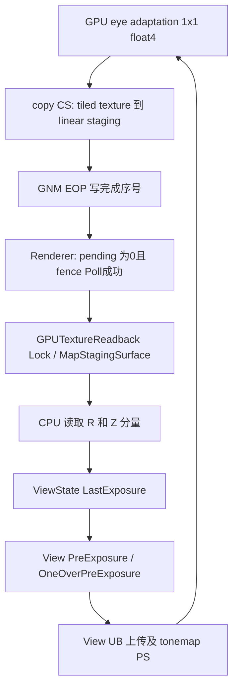

# Tetris Release-4.26 的 GnmRHI：曝光读回与 KH3 比对

2026-10-16。Tetris CUSA13427 的隔帧闪烁已定位到 **GPU 曝光结果没有写回 CPU staging 内存**。这次补出的 4.26 链路包括 Renderer 三槽历史、RHI readback wrapper、GNM fence、Map/Unmap、View UB 和 tonemap shader；不能把它写成完整恢复了 4.26 GnmRHI。

[实机验证](../validation/android-native-host/tetris-exposure-readback-20261016.md)包含有/无修复对照；[C++14 参考子集](../../tools/gnmrhi-semantics/ue426-reference/README.md)可独立编译。原有 [KH3 4.17 参考](kh3-gnmrhi-ue-reference.md)继续以 KH3 为准。

## 身份和证据等级

- Tetris 导出的原 ELF SHA256：`157845ba4297a000ac9cfeb26b7b78925d7d903a2ee34575c74d0f5ede6e9677`。
- ELF **文件偏移** `0x4afc480`、`0x4afc4be` 的 UTF16 字符串为 `++UE4+Release-4.26`、`++UE4+Release-4.26-CL-0`。这是游戏实际分支身份，不是根据发行时间猜版本。
- 以下代码地址均为 **eboot 模块偏移**；不能直接作为 guest VA 或文件偏移使用。主 RX 段的文件偏移 = 模块偏移 + `0x4000`；RELRO 用独立段映射。虚表取 `DT_SCE_RELA` 的 resolved 值，没有把原始零指针当函数。
- 文中结构偏移、UB 长度和指令立即数即使省略 `0x` 也按十六进制书写；槽数、像素数、帧数按十进制。
- 函数边界取 `.eh_frame_hdr`，用 Capstone 核对指令、交叉引用及参数传递。Reverse Study 打开返回 `database_in_use`，本轮没有取得这版游戏的 Hex-Rays 伪码；C++ 是人工语义重写。没有关闭别的 IDA 会话。
- 完整原始证据在本地 `build/validation/tetris-gnmrhi-20261016/`：ELF、`fn-*.asm.txt`、`field-ref-*.asm.txt`、虚表 JSON、PM4、CB dump 和录屏。函数名/部分结构名是候选语义名，地址和具体指令行为可核对。

## 已闭合的调用链



模拟器的关键契约位于 C→F：GPU image backing 和 guest CPU 内存不是同一份数据，仅完成 Vulkan dispatch 或写 EOP 标签不够。原生 GNM 的 Map 返回 CPU 可寻址地址，因此游戏不会再调用另一条显式复制来替模拟器补数据。

| 层 | 地址 | 已读行为 / UE 对应 |
|---|---|---|
| PS4 RHI 初始化 | `0x17a5220` | 以字符串 `PS4RHI` 加载模块，factory 结果写 `GDynamicRHI` 候选全局 `0x6a7c6c0` |
| GNM factory | `0xfc3d40` | 分配 0x38 字节，装入虚表 `0x5fce8d8`，保存到平台全局 `0x682d088` |
| View → 历史推进 | `0x22ea390` | View+15b0 取 ViewState；在其 +420 子对象调用下面的纹理历史函数 |
| 纹理历史/读回 | `0x2170ba0` | 3 个 texture、3 个 readback；消费 next 槽，向 current 槽排 copy，然后 current=(current+1)%3 |
| RDG 排读回 pass | `0x1808ca0` | 在 graph 分配 pass/参数并保存 source/readback；不是当场执行 GPU copy |
| GPUTextureReadback ctor | `0x17c9320` | 虚表 `0x60229e0`，+18 staging 初始空；基类 `0x17c8f00` 通过 DynamicRHI+0xa0 创建 fence |
| EnqueueCopy | `0x17c9980` → `0x17c93c0` | transition、按需创建 staging、录 copy、再录 fence；staging 创建实参中有 flags `0x240000`，其完整枚举解释未在本轮逐项复核 |
| Lock / Unlock | `0x17c9a60` / `0x17c9af0` | 通过 DynamicRHI 虚表 +660 / +668 进入公共 wrapper |
| Map wrapper | `0x17c8110` | 检查 fence Poll 与 pending，必要时 flush RHI thread，再通过 native slot +310 调 Map |
| GNM Map / Unmap | `0xfa13d0` / `0xfa1430` | 解出 native width/height，SDK 算基址再左移8返回地址；Unmap 真正为空 |
| GNM fence create | `0xf9ff00` | 对象 0x48 字节，4 字节对齐 label；初值/期望序号0、armed=false，虚表 `0x5fcd900` |
| fence Clear / Poll | `0xf8c380` / `0xf8c390` | Clear 仅置 +44=false；Poll 为 armed && *label==expected |
| RHI fence command Execute | `0xf9ba40` | 调 command-list context 的 +e0，然后减 fence+14 pending 写数 |
| context 写 fence | `0xf991a0` | ++fence+40；SDK 发 EOP；fence+44=true。context 表 `0x5fcdd58` 的 +e0 指向此函数 |
| EOP SDK helper | `0x3f37180` | 录6 DWORD `EVENT_WRITE_EOP`；这里只录 DCB，不是 queue submit |

### 三槽历史的准确语义

`0x2170ba0` 的子对象布局：

| 偏移 | 内容 |
|---|---|
| +0 | current index，0..2 |
| +4 | CPU LastExposure，亦即 ViewState+424 |
| +8 | 从 texel Z 读到的附加值，准确成员名未确认 |
| +10 | texture[3] |
| +28 | GPUTextureReadback*[3] |

读回开关允许、current texture 存在且 `*global(0x6b1b080)+4 == 0` 时：先通过 `0x17f7730` 注册当前纹理；检查 `readbacks[(current+1)%3]`。有 fence 则要求 pending==0 且 Poll；无 fence 的分支直接继续。Lock(16) 返回非空后复制 offset0 和 offset8 的 float，再 Unlock；随后按需创建 current 的 readback 并排 copy。**无论这次是否读回，最后都前进 current。**

不能将它解释成“帧号取模后读同一槽”。也不能套用 KH3 Dynamic buffer 的“三份 backing、每次 Lock 轮换”。这里是 Renderer 的纹理历史和异步 CPU 读回；源码中另有 `0x21710f0` 的 **buffer 变体**（单 readback +70，读回未就绪时不重排），本轮没有把它混作实测纹理路径。

### fence 与 native Map

Fence 的 +14 是尚未执行的 RHI write command 数，不是 GPU 完成值。+20 指向 label，+40 保存递增的期望值，+44 表示本代已发出；Clear 不清 label、不重置计数。这样的分层避免旧 label 恰好等于本代初值时提前消费。

`0xf991a0` 调 SDK 的固定参数得到：

```text
DWORD0 = c0044700
DWORD1 = 04000528
DWORD2 = label low32（4字节对齐，40-bit 地址）
DWORD3 = 20000000 | label high8
DWORD4 = ++expected
DWORD5 = 0
```

GNM Map native 本体不读 fence 参数，也不做 GPU copy/等待。SDK `0x3f3ae20` 根据格式/tiling 处理 base 字中的地址位，结果转 uint32 后 `<<8`。不能在通用参考实现里直接拿所有纹理的 raw DWORD0 左移代替 SDK。返回的 width 是 native texture width，不能无依据改成 byte pitch。

## CPU 常量与 shader 的逐字节连接

反射注册函数 `0x35485c0` 在 `0x3548624` 写 `PreExposure` 偏移 **874**；`0x3548500` 在 `0x3548564` 写 `OneOverPreExposure` 偏移 **878**。本次 View UB 长度 **1060**。其它 instanced/结构布局有单独注册函数，不能通用硬编码。

普通启用路径：

1. `0x22ea490` 从 View+15b0 指向的 ViewState+424 读取上次曝光。
2. `0x2171340` 初始化 ViewState+418 为1；正 override 优先，否则正 LastExposure 可替换；最后 `0x2171515` 写 View+5554。还有 show flag / 手动曝光等分支，参考子集未覆盖。
3. `0x22e8bbc` 从 View+5554 取 float，`0x22e8bcd` 写 UB+874，`0x22e8bd6` 计算1/x，`0x22e8bda` 写 UB+878。
4. 实测 tonemap PS `94e1d38583d30b84` 在 GCN +8c 用 `s_buffer_load_dword ... 0x21e` 取 **878**；+14c/150/154 和 +178/17c/180 分别乘 scene RGB、bloom RGB。VS `9836ef507aba1e47` 对 exposure texture 的 image_load 是 **dmask1**，只用 R。

正数检查没有排除“极小正 subnormal”或“巨大有限数”。原故障三周期的 `PreExposure` 位模式为 `6e754675`（约1.9e28）、`616c7073`（约2.7e20）、`0000000e`；最后一个取倒数得到 **7f800000 / +Inf**。前两个的 little-endian 字节分别是 `uFun`、`spla`，符合未更新内存的残留特征；不能仅由这四字节认定具体分配者。

## 与 KH3 Release-4.17 的实现比对

| 维度 | KH3 4.17 已有证据 | Tetris 4.26 本轮证据 / 使用限制 |
|---|---|---|
| UE 版本 | ELF Release-4.17；4.18 只校对公共接口 | ELF Release-4.26；不沿用 KH3 ABI/offset |
| 多缓冲 | 普通 Dynamic buffer 3份、逐写 Lock；提交标签另有槽 | Renderer 3 exposure textures + 3 texture readbacks；与 Dynamic Lock 无关 |
| CPU 反馈 | KH3 天空 SH 的9×1 RGBA16F RT，初始化后 CPU读取 | 每帧1×1 float4，compute copy 到 linear staging，再进 PreExposure |
| GPU→CPU 契约 | tiny RT 在 fence 前写回；频繁 RT 会被排除 | 小型 linear storage staging 必须持续写回，不能用“连续写4次就跳过”的 RT 规则 |
| RHI 分层 | `FRHICommandList` → context → LCUE / PM4 | 同样区分公共 wrapper、native DynamicRHI 和 command context；新增实际 readback/fence 虚表连接 |
| UB/shader 绑定 | packed resource maps、LCUE快照、stage dirty 已静态恢复 | trace及GCN已对上 View UB → tonemap；未把 KH3 dirty mask、对象布局迁过来 |
| GS/ES / LUT | copy VS、ring owner、LCUE selectors 已有详细静态还原 | Tetris LUT draw 确有 ES/GS、32层体积输出；本轮没有证明它的 LCUE offset/ring size 等同 KH3 |
| graphics submit | KH3 32KiB检查点、64KiB块、continuous worker | Tetris trace 是多submit构成一帧；本轮尚未重建4.26的切段/worker具体布局 |
| LS/HS/tess | KH3 SDK分支部分已读，UE选择入口仍缺 | 本轮没有 Tetris tess 执行证据，不推断它不存在或直接套用KH3 |

此次对闪烁最有用的跨版本关联是“**持有资源引用、GPU完成标签、CPU数据可见是三个独立条件**”。完成标签、全屏呈现等待、graphics LCUE表快照都不能替代 staging 内容回传。

## 已实现与后续边界

参考 C++ 保留：三槽准确消费顺序、缺 source/关闭时仍轮换、pending+Poll、R/Z读取、Clear/Poll/Write的分工、实际 EOP 字、native Map/Unmap、普通 PreExposure 更新。测试有“仅标签完成、数据仍残留”的反例，实际产生 Inf，再由写回恢复。

后续已在 [graphics专文](tetris-ue426-gnmrhi-graphics.md)恢复pipeline setter、反射消费布局、UB/loose、普通graphics LCUE和direct/indirect draw，并提供编译测试。仍需单独恢复shader loader/reflection生成、pipeline factory、完整staging texture创建flags、copy/transition SDK、buffer readback变体、完整GS/ES/LS/HS对象寿命和queue worker。没有把未知项补成成功占位。新函数尚未写入游戏v2符号包；后续导出应使用该ELF SHA的独立索引。16像素阈值与32³ LUT的实际路径区别见graphics专文§9。
